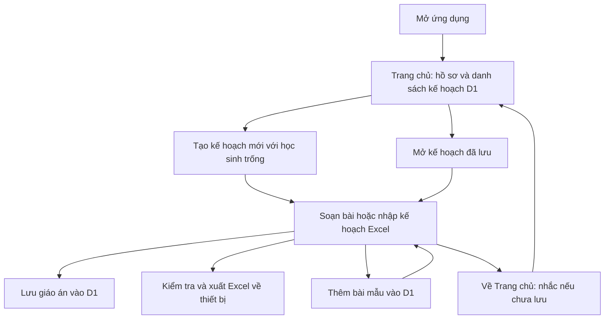

# Luồng ứng dụng kế hoạch giáo dục cá nhân

Tài liệu mô tả bản code hiện tại. Các chức năng lưu dữ liệu hoạt động khi Worker đã được deploy, D1 được gắn với binding `DB` và migration đã tạo các bảng cần thiết.

## 1. Mở ứng dụng

1. Ứng dụng đọc danh mục gốc và bố cục xuất Excel từ `src/data/lesson-template.json`. Người dùng không cần tải file mẫu.
2. Màn hình **Trang chủ** đọc hồ sơ user và danh sách kế hoạch đã lưu từ D1, sắp xếp theo lần cập nhật mới nhất.
3. Tìm kế hoạch theo tên hoặc tháng/năm. Bấm **Mở kế hoạch** để khôi phục toàn bộ nội dung đã lưu.
4. Bấm **+ Tạo kế hoạch mới** để tạo giáo án trong bộ nhớ, với UUID mới, tháng/năm hiện tại và một tab học sinh trống. Giáo viên được tự điền bằng **Cô + first_name** của user hiện tại, mặc định **Cô Hoà**.
5. Trong màn hình soạn, ứng dụng đọc bài tự thêm từ D1 rồi ghép với danh mục gốc. Kế hoạch mới chỉ xuất hiện trên Trang chủ sau khi bấm **Lưu giáo án**.

Nếu không đọc được D1, danh mục gốc vẫn dùng được để soạn và xuất Excel. Ứng dụng báo lỗi và có nút **Thử lại**; dữ liệu chưa được lưu chỉ nằm trong bộ nhớ của trang.

## 2. Soạn giáo án và quản lý học sinh

Mỗi giáo án chứa một hoặc nhiều học sinh. Mỗi học sinh có thông tin riêng và danh sách bài riêng.

- Nhập họ tên, tuổi, giáo viên, QLCM và tháng/tuần của học sinh.
- Tab hiển thị tên học sinh, số bài và nút **×**.
- Tab cuối **Thêm học sinh +** mở danh sách học sinh của user hiện tại. Tìm theo tên, chọn một hoặc nhiều học sinh rồi bấm **Thêm … học sinh**. Có thể tạo hồ sơ mới ngay trong hộp thoại. Tab mới dùng tên và tuổi từ hồ sơ, giáo viên/QLCM/tháng-tuần từ tab đang mở, với danh sách bài trống. Tab đầu trống được thay bằng các học sinh đã chọn.
- Bấm tab để chuyển học sinh.
- Bấm **×** rồi xác nhận để bỏ học sinh khỏi giáo án đang soạn. Nếu bỏ học sinh cuối cùng, ứng dụng tạo lại một tab trống.

Việc bỏ học sinh chưa tự cập nhật giáo án trong D1. Người dùng phải bấm **Lưu giáo án** để lưu thay đổi đó.

Giới hạn hiện tại là 100 học sinh trong một giáo án và 2.310 hàng bài cho mỗi học sinh. Giới hạn dung lượng lưu giáo án là 1,8 MB, nên giáo án có nhiều nội dung dài có thể cần chia nhỏ trước khi đạt giới hạn số hàng.

## 3. Chọn và chỉnh bài học

1. Bấm **+ Thêm bài** trong bảng kế hoạch. Ứng dụng tạo một hàng trống và mở ô tìm bài.
2. Tìm theo mã bài, tên hoặc mục tiêu; danh sách gồm bài gốc và bài tự thêm. Không cắt kết quả ở 100 bài.
3. Tích một hoặc nhiều bài, rồi bấm **Áp dụng**. Các bài trở thành những hàng riêng theo thứ tự chọn, ngay tại vị trí hàng đang sửa.
4. Chọn điểm cần đạt nếu bài có các mức điểm. Nếu bài chưa có thang điểm, nhập điểm thủ công.
5. Nội dung có trong tham khảo được hiển thị chỉ đọc. Nội dung còn thiếu cho phép nhập thủ công. Tiêu chí phụ thuộc vào mức điểm được chọn.
6. Nhập ghi chú cho từng bài.
7. Kéo tay nắm hoặc dùng nút lên/xuống để đổi thứ tự. Điểm, ghi chú và nội dung đi cùng hàng khi di chuyển.
8. Bấm **×** trên hàng để bỏ bài khỏi giáo án đang soạn.

Một mã bài không được chọn hai lần cho cùng một học sinh. Các học sinh khác nhau có thể dùng cùng một bài.

Phần tham khảo nằm tại route **Thư viện** `/library/`. Tìm bài theo mã/tên/mục tiêu và bấm **Chi tiết** để xem nội dung và thang điểm. Màn hình Kế hoạch chỉ hiển thị thông tin học sinh và bảng bài đang soạn; ô chọn bài vẫn lấy toàn bộ danh mục gốc và bài tự thêm.

## 4. Thêm bài mẫu

1. Vào **Thư viện** và bấm **Thêm bài mẫu**.
2. Nhập mã bài và tên bài bắt buộc; nhập mục tiêu, hướng dẫn và tiêu chí chung nếu có.
3. Bấm **+ Thêm mức điểm** để khai báo các mức điểm và tiêu chí tương ứng. Có thể bỏ qua thang điểm để nhập điểm thủ công khi sử dụng bài.
4. Bấm **Lưu bài mẫu**.
5. Worker kiểm tra dữ liệu và mã trùng. Mã không được trùng danh mục gốc hoặc bài đã lưu cho user hiện tại; so sánh không phân biệt chữ hoa/thường và khoảng trắng.
6. Khi D1 lưu thành công, bài xuất hiện trong Thư viện và ô chọn bài. Khi mở ứng dụng lần sau, bài được đọc lại từ D1.

Thêm bài mẫu không tự thêm bài vào giáo án đang soạn. Người dùng chọn bài đó qua **+ Thêm bài** như các bài khác.

Hiện chưa có chức năng sửa hoặc xóa bài mẫu đã lưu. Việc xóa một hàng trong giáo án không xóa bài mẫu khỏi danh mục.

## 5. Lưu giáo án

1. Bấm **Lưu giáo án** trên header.
2. Nhập tên giáo án, mặc định là tên đã lưu hoặc "Giáo án tháng …".
3. Bấm **Lưu giáo án** trong hộp thoại.
4. Ứng dụng gửi toàn bộ tab học sinh, thông tin, hàng bài, điểm, ghi chú, nội dung thủ công và bản sao các bài đang sử dụng tới Worker.
5. Worker kiểm tra dữ liệu rồi lưu vào D1 theo UUID giáo án và user ID hiện tại.

Có thể lưu giáo án đang soạn dở, gồm học sinh chưa có tên, chưa có bài hoặc chưa chọn điểm. Các điều kiện để xuất Excel sẽ được kiểm tra riêng khi xuất.

Lần lưu đầu tạo bản ghi mới. Những lần lưu tiếp theo cập nhật cùng giáo án, kể cả khi đổi tên. Lưu một giáo án đã mở không tạo bản sao mới.

Mỗi lần lưu tăng số phiên bản. Nếu hai cửa sổ cùng mở một giáo án, cửa sổ dùng phiên bản cũ sẽ được báo xung đột thay vì ghi đè bản mới. Người dùng cần mở lại giáo án để lấy phiên bản hiện tại.

Ứng dụng **không tự động lưu** khi gõ. Xuất Excel cũng không tự lưu giáo án vào D1.

## 6. Mở giáo án đã lưu

1. Từ Trang chủ bấm **Mở kế hoạch**.
2. Worker trả danh sách giáo án của user hiện tại, theo lần cập nhật mới nhất.
3. Danh sách hiển thị tên giáo án, tháng/năm và thời điểm cập nhật.
4. Bấm **Mở** ở giáo án cần tiếp tục.
5. Ứng dụng khôi phục học sinh, tháng/năm, thứ tự bài, điểm, ghi chú và nội dung đã lưu; tab học sinh đầu tiên được mở.

Mở giáo án thay thế nội dung đang soạn trong trang. Hộp thoại nhắc người dùng lưu trước nếu cần giữ nội dung đó.

Bản sao nội dung bài được lưu cùng giáo án, nên giáo án mở lại dùng nội dung tại thời điểm lưu, kể cả khi danh mục gốc thay đổi sau này.

Hiện chưa có chức năng xóa giáo án khỏi thư viện hoặc "Lưu thành bản sao".

## 7. Nhập kế hoạch Excel cũ

1. Bấm **Tải kế hoạch có sẵn**, chọn một file `.xlsx` theo cấu trúc kế hoạch được hỗ trợ.
2. Ứng dụng đọc file ngay trên trình duyệt. Mỗi sheet kế hoạch có đúng cột A:F ở hàng 8 được chuyển thành một học sinh.
3. Thông tin học sinh, mã bài, nội dung, điểm, tiêu chí và ghi chú được nhập theo thứ tự hàng. Mã bài được đối chiếu với danh mục hiện tại để lấy UUID.
4. Học sinh nhập thêm vào giáo án đang soạn. Nếu trang chỉ có tab đầu tiên chưa có tên và chưa có bài, tab đó được thay bằng dữ liệu nhập.
5. Nội dung nhập từ Excel cho phép chỉnh sửa trực tiếp, kể cả các nội dung vốn có trong tham khảo.
6. Bấm **Lưu giáo án** nếu muốn giữ bản nhập trong D1, hoặc **Xuất Excel** để tạo file mới.

Nhập Excel không tự lưu vào D1. Ứng dụng báo lỗi nếu mã bài không có trong danh mục, mã bài lặp trong một học sinh hoặc vượt giới hạn. Không thêm một phần dữ liệu khi việc đọc file bị lỗi. Chỉ hỗ trợ `.xlsx` tối đa 30 MB, không phải một file Excel tùy ý với bố cục khác.

## 8. Xuất Excel

1. Bấm **Xuất Excel** trong màn hình Kế hoạch hoặc cạnh một kế hoạch đã lưu trên Trang chủ.
2. Ứng dụng kiểm tra từng học sinh: có họ tên, có ít nhất một bài hợp lệ, không lặp bài và có điểm cần đạt hợp lệ.
3. Nếu đủ điều kiện, hộp xuất cho chọn tháng/năm dùng cho tên file.
4. Tạo một workbook, mỗi học sinh một sheet, theo thứ tự tab. Bài học xuất theo thứ tự trong bảng; ghi chú xuất cùng bài.
5. Xuất dùng danh mục đang mở, gồm bài gốc, bài tự thêm và bản sao nội dung của giáo án đã lưu.
6. Nếu trình duyệt hỗ trợ, chọn thư mục rồi bấm **Lưu workbook**. Có thể dùng **Tải xuống qua trình duyệt** để tạo liên kết tải file.

File có dạng `KeHoach_Thang{thang}_{nam}.xlsx`. Khi lưu trực tiếp vào thư mục, ứng dụng thêm `_v2`, `_v3`… nếu tên trùng. Với tải xuống, trình duyệt quyết định thư mục và xử lý tên trùng.

File xuất giữ bố cục, logo và định dạng. File chứa nội dung, không chứa công thức hoặc sheet tham khảo. Tạo file chạy trên thiết bị; file Excel không được tải lên server trong luồng này.

## 9. Về trang chủ, bắt đầu kế hoạch mới và đóng trang

- Mục **Trang chủ** trên sidebar quay về danh sách và tải lại các kế hoạch đã lưu. Nếu còn thay đổi chưa lưu, ứng dụng hỏi xác nhận trước khi rời màn hình soạn. Bấm **Giữ lại** để tiếp tục và lưu.

- Từ Trang chủ, bấm **Tạo kế hoạch mới** để tạo UUID giáo án mới và một học sinh trống; bài mẫu đã lưu trong D1 vẫn được giữ.
- Giáo án đã lưu trong D1 không bị xóa khi bắt đầu kế hoạch mới hoặc đóng trang.
- Nội dung chỉnh sửa sau lần lưu gần nhất chưa được lưu bền vững. Trang có cảnh báo khi rời đi nếu còn thay đổi chưa lưu, nhưng người dùng vẫn cần chủ động lưu.
- Tải lại trang mở Trang chủ. Chọn **Mở kế hoạch** để tiếp tục giáo án cũ.

## 10. Dữ liệu và danh tính

| Dữ liệu | Nơi lưu |
|---|---|
| Danh mục 970 bài gốc, UUID và bố cục xuất | JSON trong repo |
| Hồ sơ người dùng | Bảng `users` trong D1 |
| Bài mẫu tự thêm | Bảng `lessons` trong D1 |
| Giáo án đã lưu, nội dung bài và phiên bản | Bảng `plans` trong D1 |
| Các thay đổi đang soạn chưa bấm lưu | Bộ nhớ trang trên trình duyệt |
| File Excel xuất | Thiết bị người dùng |

ID bài, điểm, hàng tham khảo, học sinh, hàng giáo án và giáo án dùng định dạng UUID. Mã bài như `A1` hoặc `M001` dùng để hiển thị, tìm kiếm và trao đổi qua Excel; không thay cho ID nội bộ.

Hiện chưa đăng nhập. Worker sử dụng một user ID cố định phía server, nên mọi người sử dụng bản cài đặt này dùng chung thư viện bài mẫu và giáo án. User ID cố định không phải cơ chế xác thực.

Bảng `users` lưu UUID, `first_name`, `last_name` và thời điểm tạo/cập nhật. Migration `0002_users.sql` tạo hồ sơ **Cô Hoà** cho UUID cố định hiện tại và bổ sung hồ sơ cho các chủ sở hữu dữ liệu cũ. Chưa có đăng nhập; người dùng ứng dụng vẫn dùng chung tài khoản cố định.

## 11. Sidebar và route

- **Trang chủ** `/`: xem và tìm kế hoạch đã lưu, tạo kế hoạch mới, mở kế hoạch.
- **Kế hoạch** `/plans/`: soạn kế hoạch mới. Kế hoạch đã lưu mở ở `/plans/?id=UUID`, tải lại URL này sẽ khôi phục bản đã lưu.
- **Thư viện** `/library/`: xem bài gốc và bài tự thêm, tìm theo mã/tên/mục tiêu, xem chi tiết và thêm bài mẫu.
- Sidebar đánh dấu trang đang mở, hỏi xác nhận nếu chuyển trang khi có thay đổi chưa lưu.

Migration `0003_user_names.sql` đổi `display_name` thành `first_name` và `last_name`, giữ UUID và thời điểm tạo/cập nhật. Hồ sơ cố định hiện tại có `first_name = Hoà`, `last_name` trống. Thông tin giáo viên của kế hoạch cũ giữ nguyên; kế hoạch mới lấy tên từ hồ sơ user.

Trang Kế hoạch chỉ có ba thao tác trên header: **Lưu giáo án**, **Tải kế hoạch có sẵn**, **Xuất Excel**. Điều hướng dùng sidebar; mở hoặc tạo kế hoạch thực hiện ở Trang chủ.

## 12. Hồ sơ học sinh và lượt xuất

`students` lưu UUID, tên, tuổi và thời điểm tạo/cập nhật. `student_teachers` liên kết nhiều học sinh với nhiều user, khóa chính là cặp student/user. `studentId` trong tab kế hoạch trỏ tới hồ sơ; UUID của tab vẫn riêng. Kế hoạch cũ và Excel nhập chưa có `studentId` vẫn được hỗ trợ. Chỉnh tên/tuổi trong tab là chỉnh bản kế hoạch, không tự đổi hồ sơ dùng chung. Xóa tab không xóa hồ sơ học sinh.

Hồ sơ tạo qua hộp Chọn học sinh được lưu ngay vào D1, dù kế hoạch chưa lưu. Migration đưa các học sinh có tên trong giáo án cũ vào danh sách. Mỗi học sinh được chọn tối đa một tab trong một kế hoạch. API liên kết giáo viên khác là `POST /api/students/:id/teachers` với `userId`; hiện chưa có màn hình phân công giáo viên hoặc đăng nhập.

`plan_exports` lưu từng lượt bằng UUID. Trang chủ hiển thị tổng số lượt của từng kế hoạch. Mở hộp xuất và tạo file xem trước không tăng số lượt; nhấn **Tải file** ghi nhận yêu cầu tải xuống, lưu vào thư mục ghi nhận sau khi file được ghi thành công. Gửi lại cùng UUID không tăng hai lần. Trình duyệt không xác nhận người dùng có giữ file tải xuống hay không. Lượt xuất không tăng revision và không đổi thời điểm sửa kế hoạch. Kế hoạch chưa lưu vẫn xuất được nhưng chưa có bộ đếm.

## 13. Quản lý học sinh và autocomplete

Sidebar mặc định thu gọn thành icon. Nút **Mở rộng sidebar** hiện tên các mục; **Thu gọn sidebar** trở về icon. Trạng thái giữ khi chuyển route và mặc định thu gọn sau khi tải lại trang.

Mục **Học sinh** `/students/` hiển thị danh sách của giáo viên hiện tại, có tìm theo tên/tuổi, tạo và sửa tên/tuổi. Khi lưu sửa, API kiểm tra thời điểm cập nhật để tránh ghi đè hồ sơ đã được giáo viên khác sửa. Hồ sơ dùng chung thay đổi, còn bản kế hoạch đã lưu giữ nguyên nội dung.

Trong Kế hoạch, nhấn ô tên học sinh để mở danh sách gợi ý. Gõ để lọc, chọn bằng chuột hoặc ↑/↓ và Enter. Chọn điền tên, tuổi và `studentId`, giữ nguyên các bài đang soạn. Học sinh đã ở tab khác được loại khỏi gợi ý. Gõ tên tự do bỏ liên kết `studentId`; tạo hồ sơ dùng lại tại mục Học sinh hoặc hộp Thêm học sinh.
