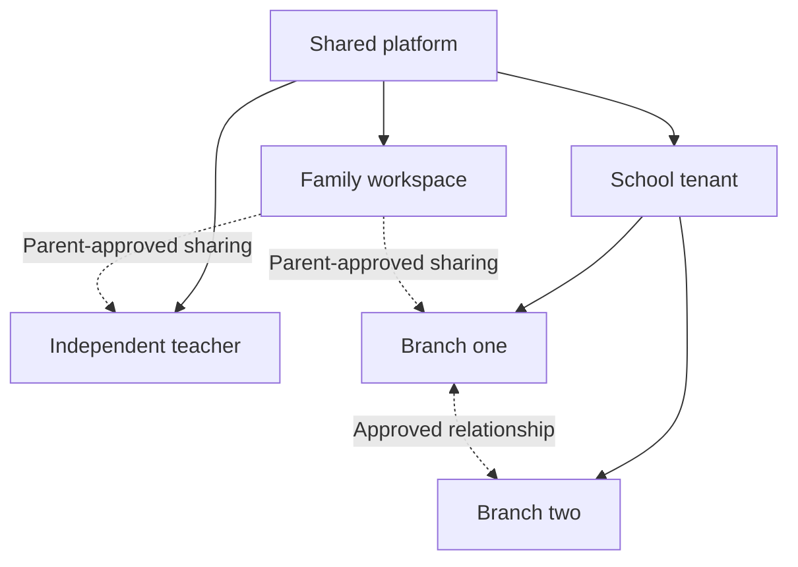
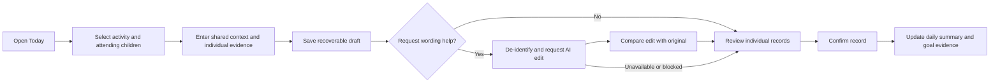
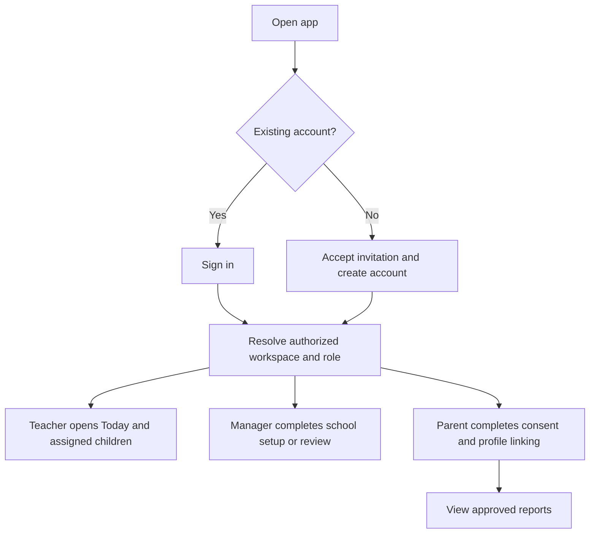
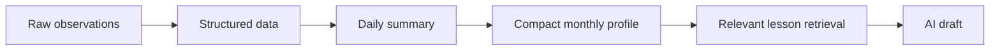
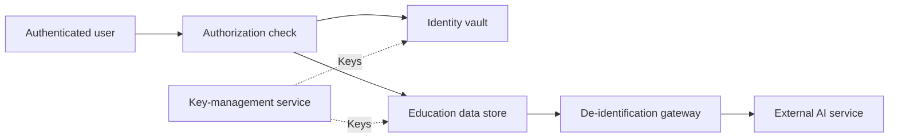
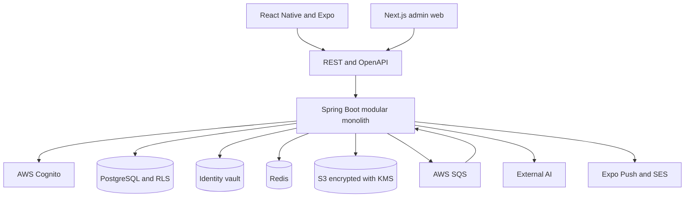

# BMTC application specification

> Document ID: BMTC-PRODUCT\
> Version: 1.1.0\
> Status: Teacher pilot specification with a phased product roadmap\
> Updated: October 11, 2026\
> Language: English

## How to use this document

This file combines the documents needed to begin product design and software development. Each section corresponds to a document that would normally be maintained separately, including the Product Brief, PRD, permission matrix, user flows, data model, AI specification, security requirements, test plan, and operating plan.

Detailed engineering design is maintained separately in [BMTC-TECH 1.0.0](technical-specification-v1.md), aligned with this product version. This file remains the authority for product behavior, release scope, and confirmed architecture constraints. Its technical sections provide the high-level context; the technical specification expands implementation details and identifies proposals separately. See the [documentation guide](README.md) and [change log](CHANGELOG.md) for version management.

Decisions use three statuses:

- **Confirmed**: ready to guide design and development.
- **Provisional**: suitable for planning but must be reviewed before release.
- **Open**: more information or a decision is required.

A confirmed product rule does not imply inclusion in the first release. Section 6.4 defines the pilot scope for every functional requirement group. Later-phase requirements remain part of the product direction and apply when those features are introduced. In this version, MVP means the teacher pilot. Proposed cohort sizes and success thresholds remain provisional until baseline measurement.

---

## 1 Product summary

The product is a multi-tenant platform for schools, independent teachers, and families of children who need special education support. It helps users record daily activities, track goals, prepare lesson plans, manage classes, report progress to parents, and run school operations.

BMTC supports special education needs broadly. Autism is one possible context, not the defining focus of the product. Vietnam is the only current market; expansion to other countries and multilingual product support are outside the current scope.

Schools purchase premium capabilities as enterprise or team customers. Freelance teachers and parents can purchase premium capabilities as personal customers. The feature packages, prices, and payment terms remain open.

The platform uses AI to edit notes and draft lesson plans. AI must not diagnose a child, invent facts, or replace professional judgment. All data sent to an external AI service must be de-identified and limited to what the task requires.

The pilot serves teachers who support children daily. Its primary value is helping a teacher review today's activities and goals, record useful observations quickly, and reuse confirmed evidence in summaries and parent reports.

The pilot must demonstrate less documentation and report-preparation work without reducing the quality of the child's record. Teachers are the primary users and the main source of pilot feedback. Managers support setup and report approval; parents use a limited profile, consent, and report-viewing flow.

Screening is an occasional need and is deferred to a later, separately reviewed release. It is not a pilot entry point, recruitment requirement, or measure of success. Its existing safeguards remain part of the future specification.

---

## 2 Confirmed decisions

### 2.1 Organization model

- Each school is an independent tenant.
- A school may have multiple branches.
- Each branch has a manager whose permissions are limited to that branch.
- A school administrator can manage every branch in the school tenant.
- A teacher may work at multiple branches of the same school.
- A user may simultaneously hold teacher and manager roles within the granted scope.
- An independent teacher has a separate personal workspace.
- A family can use the app without linking to a school.
- Schools cannot access one another's records or lesson libraries unless they establish an explicit relationship and sharing scope.
- The product uses one shared mobile app with role-aware workspaces, plus a web portal for complex administration.
- The platform has a Platform Super Admin role for tenant lifecycle, global configuration, and platform operations.
- A Platform Super Admin has no default access to child identity data, observations, screening results, or professional records.
- Support access to tenant data requires a separate grant with a reason, scope, expiry, approval, and audit trail.

### 2.2 Control of a child's records

- The parent controls the child's core profile.
- A school or independent teacher controls the professional records they create.
- Linking parties does not merge all their data.
- A parent must consent before a school or independent teacher receives access to shared information.
- A QR code starts the linking process. It contains no sensitive data and does not automatically grant broad access.

### 2.3 AI and data

- The platform will use an external AI service.
- Identifying data must be removed before a request is sent to AI.
- Names, addresses, phone numbers, images, and directly traceable internal identifiers must not be sent.
- AI receives only the minimum data required for the task.
- The AI provider must not train its models on children's data.
- For teacher notes, AI may edit wording only. It must not classify behavior, diagnose a condition, or add facts.
- A teacher must review and confirm AI-generated text.

### 2.4 Teacher observations

- A child may have multiple records in one day, with each record linked to a lesson or activity.
- Activities may come from the timetable or be added manually.
- Activities include group lessons, individual lessons, meals, hydration, sleep, rest, and other routines.
- A teacher can write observations separately for each student or start with a class-wide observation and adjust individual records.
- The system always saves a separate record for each child.
- Forms combine predefined choices with free-text notes.
- Each activity belongs to a lesson type such as fine motor, gross motor, communication, cognition, social interaction, self-care, or sensory regulation.
- Each lesson type has its own quick observation choices.
- The platform provides an initial taxonomy; a school or manager configures shared choices; an independent teacher manages a private taxonomy.
- A school teacher may manage favorites and personal choices but cannot directly change the shared taxonomy.
- A teacher maintains personal choices that apply across their classes, not separate choices for each child.
- When a lesson type or choice is retired, historical records preserve the label and meaning used at the time.
- A teacher can save and update a record more than once.

### 2.5 Reports

- The system creates daily, weekly, and monthly summaries.
- Detailed journals and daily or weekly reports are for internal use.
- Parents receive a general monthly report.
- The teacher prepares or reviews the report.
- A manager approves it before release to the parent. During the pilot, the approver must be a different person from the report author.
- The parent receives a notification when a report is ready.
- A push notification contains no sensitive report content. The parent must sign in to read it.

### 2.6 Lesson plans

- The system supports group lessons and individual sessions.
- Teachers may create and edit lesson-plan drafts.
- A manager approves a lesson plan before use.
- An approved lesson plan is not overwritten. An edit creates a new version that requires approval.
- Each school has a private lesson library.
- AI retrieves a small set of relevant, approved lessons and uses them to create a personalized draft.
- A group lesson contains shared content and child-specific adjustments.

### 2.7 Classes and schedules

- The school manages classes, rooms, teachers, students, and timetables.
- The schedule supports recurring events, holidays, make-up lessons, rescheduling, and ad hoc sessions.
- A teacher may request a schedule change. The branch manager approves it.
- A teacher's calendar combines sessions from every branch where they work.
- The system checks conflicts involving teachers, students, rooms, and travel time.
- Conflicts between branches are escalated to the school administrator.
- After each session, the system reminds the teacher to record observations for the relevant students.

### 2.8 Payroll management

- The system calculates payroll and produces payslips. It does not transfer money.
- Compensation combines a base salary with pay by teaching hour or session.
- A teacher level determines the base salary and teaching rates.
- Group-session and individual-session rates are configured separately.
- Each school defines its own teacher levels and rates.
- Every level or rate change has an effective date.
- A branch manager confirms work records. A school-level user or accountant approves payroll.

General formula:

```text
Period pay = Base salary for teacher level
           + Approved group sessions × Group-session rate for level
           + Approved individual sessions × Individual-session rate for level
           + Allowances and additional teaching pay
           - Unpaid leave and deductions
```

### 2.9 Guest screening

Release scope: deferred beyond the teacher pilot. The following rules apply when screening is released.

- A user may sign in or skip account creation.
- Guest data is stored only on the device and must be encrypted.
- The app warns that guest data may be lost if the app is deleted, app data is cleared, or the user changes devices.
- A guest result cannot be transferred into an account created later.
- A screening result is not a diagnosis and must not be described as an autism severity level.
- Before a standardized screening, the system may ask up to 10 adaptive intake questions about age, caregiver concerns, and observable behavior.
- Intake questions are for routing only. They do not create a risk score and must not be described as a shortened standardized tool.
- M-CHAT-R/F or another standardized tool must be used with its applicable age range, complete items, scoring rules, follow-up process, and license requirements.
- CARS-2 is a professional observational assessment, not a short self-service quiz for general users.
- Users enter chronological age from date of birth. Developmental or behavioral age is stored only when it comes from a sourced, dated professional assessment.

### 2.10 Retention after a child leaves a school

- **Provisional**: the school retains its professional records for three months after the child leaves.
- After that period, the school loses access and its professional records are deleted or anonymized according to policy.
- The core profile in the family account remains available.
- The three-month period requires legal review before release.

### 2.11 Onboarding and workspace switching

- The pilot entry screen offers sign-in or accepting a school invitation. Account creation continues within the invitation flow where needed.
- Returning teachers open Today in their last authorized workspace, with the active school, branch, and role visible.
- Teachers join a participating school with a code or QR invitation. The pilot uses teachers in school or center teams; independent workspaces remain a later release.
- Authorized school registration creates the tenant and first named branch; the creator becomes the school administrator. The administrator sets up classes and students and invites teachers. Initial setup may be assisted by the pilot team.
- Invited parents create a minimal child profile or link an existing profile, provide the required consent, and access approved reports.
- A user with several roles or tenant memberships changes context with a workspace switcher and always sees the active role.
- An account's initial role does not permanently lock its type. Later releases may add independent-teacher onboarding and public screening without changing this rule.

### 2.12 Technology and architecture

- The backend uses an LTS Java release, Spring Boot, and Spring Modulith.
- The system starts as a modular monolith. The MVP does not use microservices.
- Pragmatic DDD defines business modules and data ownership. Hexagonal architecture is applied at seams with real adapters, including AI, notifications, object storage, and the identity provider.
- Spring MVC is the HTTP adapter. Controllers contain no business rules and do not access repositories directly.
- The administration web application uses Next.js and TypeScript. The mobile application uses React Native, Expo, and Expo Router.
- The backend exposes REST endpoints described by OpenAPI. Web and mobile use a generated TypeScript client.
- PostgreSQL is the primary database. All tenant-owned data uses `tenant_id` and PostgreSQL Row Level Security.
- Flyway manages the schema. jOOQ generates Java types from that schema and executes queries. The MVP does not use Hibernate or JPA.
- The system uses CQRS within the same database. Commands pass through application handlers and the domain model; queries use jOOQ to return read models or DTOs.
- Domain code does not import Spring MVC, jOOQ, the AWS SDK, or adapter classes.
- AWS is the initial target environment, including ECS Fargate, RDS PostgreSQL, S3, KMS, SQS, ElastiCache, Cognito, SES, and CloudWatch. The data region remains subject to legal review.
- GitHub Actions and Docker provide CI/CD. Terraform or OpenTofu manages infrastructure.

### 2.13 Teacher pilot priority

- Teachers who perform recurring observation and reporting work are the primary pilot participants.
- Product decisions prioritize the complete daily teacher workflow and measurable time savings.
- Screening is deferred and does not block teacher onboarding or pilot release.
- Basic goals and one monthly report format are included so teachers can reuse daily records during the pilot.
- School operations beyond the minimum needed to support participating teachers remain later-phase work.

### 2.14 Population and market

- **Confirmed**: the product supports children needing special education support broadly and is not limited to autism.
- **Confirmed**: Vietnam is the only current market. International expansion and multilingual product support are not current requirements.
- The English language of this specification does not define the application's interface language.
- Autism-specific screening references describe possible future tools only. They do not define the full population served by BMTC.
- Supported ages and the responsibilities of each professional role remain separate decisions. The non-diagnostic rules continue to apply across all support needs.

### 2.15 Paying customers and premium access

- **Confirmed**: schools are enterprise or team customers that pay for premium capabilities in their school workspace.
- **Confirmed**: freelance teachers and parents are personal customers who can pay for premium capabilities for their own use.
- Freelance teacher and independent teacher refer to the same user category in this document.
- Customer type does not replace the role and workspace model. A person can have school membership and a personal workspace under the same account.
- Premium access controls feature availability and usage limits. Payment does not grant access to a child's records or replace role, assignment, or consent checks.
- Exact prices, premium features, charging units, billing frequency, and free-access limits remain open. No payment provider is selected by this decision.
- Whether one personal purchase covers both parent and freelance-teacher use, or requires separate plans, remains open.
- The handling of existing records, approved reports, and exports after a downgrade or payment failure remains open and must be defined before paid plans launch.

---

## 3 Product Brief

### 3.1 Problem

Teachers record many activities during the day and later prepare summaries and lesson plans. Records are often fragmented, difficult to review over time, and missing useful context. Schools need to manage schedules, classes, staff, and approval workflows while keeping each child's data isolated, secure, and auditable.

Parents need a clear progress channel and control over sharing. Initial screening and provider discovery are later product needs.

For the pilot, the problem to validate is repeated teacher effort: entering observations, finding recent evidence, and rewriting that evidence for reports. Frequent use is a reason to recruit teachers, but continued use and time savings must be measured rather than assumed.

### 3.2 Product goals

Pilot goals:

- Reduce total teacher time spent recording observations and preparing reports.
- Make today's sessions, assigned children, current goals, and unfinished records easy to find.
- Preserve context, individual evidence, and change history.
- Reuse confirmed observations in daily summaries and one reviewed monthly report format.
- Keep entry usable during an AI outage and protect drafts during short network interruptions.
- Preserve consent, access controls, privacy, and recovery throughout the pilot.

Later product goals include approved lesson planning, broader school operations, independent-teacher workspaces, and separately governed screening and provider discovery.

### 3.3 Outcomes to measure

The primary outcome is the change in teacher documentation and report-preparation time for comparable workloads. Measure baseline time before app use and include corrections, repeated entry, and report revisions in the pilot total. Track manager review time separately to detect work shifted from teachers to managers.

| Measure | Definition and purpose |
|---|---|
| Teacher time saved | Compare observation-entry time per attended child-session and preparation time per report with baseline, accounting for class size and session type |
| Continued teacher use | Percentage of participating teachers completing the core workflow on their scheduled teaching days; exclude leave and non-teaching days |
| Same-day completion | Percentage of required observations confirmed that day; exclude canceled sessions, absent children, and activities that do not require a record |
| Evidence quality | Review a sample for factual accuracy, individual context, support provided, and traceable source observations |
| Report workload | Measure teacher preparation and manager review time, returns for changes, and on-time release |
| Draft reliability | Track lost drafts, duplicate saves, synchronization failures, and recovery outcomes |
| AI usefulness | Track optional use, editing time, rejection, and changes in meaning; acceptance alone is not evidence of correctness |
| Operational feasibility | Record school setup effort, support requests, and the willingness of teachers and decision-makers to continue |

Measure product usage without placing child content in analytics. Security isolation and backup restoration are release requirements, not substitutes for evidence of teacher benefit. Screening completion and sign-up counts are excluded from pilot success measures.

### 3.3.1 Pilot participants and evaluation

- **Confirmed**: recruit teachers who already document child activities and prepare recurring reports.
- **Provisional**: start with 8 to 12 teachers across 2 or 3 schools or special education centers, using one branch at each site. Include group and individual teaching and different levels of phone confidence.
- Include one responsible manager per site for onboarding, permissions, and report review. Parents participate only where consent, linking, or report feedback is needed.
- **Provisional**: measure one working week of current daily documentation and time at least one complete report-preparation task, then run the app for six weeks, including at least one monthly report cycle. Separate first-week training effects from later use.
- **Provisional**: aim for at least 30% less combined teacher documentation and report-preparation time and at least 80% of participants using the core workflow on at least 80% of their scheduled teaching days during the final two weeks.
- Confirm the measurement method and thresholds after baseline measurement and before app use. Record any later changes and their reasons.
- Continue only if sampled record quality is acceptable, manager work has not offset teacher savings, and no unresolved critical privacy, access, or data-loss failures remain.
- If teachers still repeat the same work outside the app or require constant reminders to use it, revise the workflow before expanding scope. Do not count mandated use alone as evidence of value.
- The initial cohort uses school teams to retain an existing review and consent structure. Whether independent teachers should form the next cohort remains an open decision.

### 3.4 Out of scope for the MVP

- Account and guest screening, adaptive intake, and public screening onboarding.
- Independent-teacher workspaces and self-service family acquisition.
- Full lesson libraries, lesson approval, and AI lesson generation.
- Advanced scheduling, cross-branch conflict handling, payroll, handoff, and in-app incident management.
- Provider discovery, home journals, and school-to-school sharing.

The following product exclusions also remain in force:

- Diagnosing autism or another condition.
- Making an unsupervised professional decision.
- Sending salary payments through a bank or payment gateway.
- Sharing all lesson libraries publicly across schools.
- Ranking children, teachers, or schools with an AI-generated composite score.
- Importing a guest screening result into an account created later.

### 3.5 Customer and commercial model

| Paying customer | Customer category | Intended premium scope |
|---|---|---|
| School or special education center | Enterprise or team | Premium school capabilities used by authorized members within the school workspace |
| Freelance teacher | Personal | Premium capabilities for independent teaching work |
| Parent | Personal | Premium capabilities for supporting their child or children |

This customer model applies to the full product. The teacher pilot remains the first delivery phase. Defining a paying customer does not add their entire premium offering to the pilot.

The premium feature matrix and package boundaries must be specified separately. Family access to school-shared reports, sharing between guardians, and the effect of school membership on personal premium access are not settled by the customer categories above.

BMTC product payments are separate from a school's tuition collection or teacher payroll. This commercial decision does not add tuition billing or salary transfers to the platform scope.

---

## 4 Users and workspaces

Pilot priority: school teachers are primary users. Managers and school administrators provide essential setup and review. Parents have a limited consent, profile, and approved-report experience. The table also includes later-phase roles; their presence does not expand pilot scope.

| User group | Primary goal | Workspace |
|---|---|---|
| Platform Super Admin | Manage tenant lifecycle, platform configuration, operations, and time-bounded support access | Platform scope with no default access to child data |
| Parent or guardian | Manage the core profile, screen, keep a simple home journal, receive reports | Family |
| School teacher | View schedule, write observations, prepare lessons, follow assigned students | Assigned school tenant and branches |
| Independent teacher | Manage private students, schedule, journals, and lessons | Independent teacher workspace |
| Branch manager | Manage classes, schedules, rooms, approvals, and work records | One branch |
| School administrator | Manage branches, shared policies, and cross-branch decisions | Entire school tenant |
| Accountant or HR user | Manage contracts, work records, payroll, and payslips | Granted payroll scope |
| Support specialist | View only the information required for an assigned role | Explicitly authorized scope |

---

## 5 Tenant and data-ownership model



### 5.1 Data principles

- Identity data and education data belong to separate data domains.
- Education records use a random child identifier, not a real name as the key.
- A tenant owns the professional data it creates.
- A family controls the parent-child relationship and the child's core profile.
- A cross-party link is a scoped, time-bounded access grant. It is not a full copy of the record.
- Revoking a link stops access immediately. Retained records follow the published retention policy.

---

## 6 MVP scope

### 6.1 Daily teacher flow

1. Sign in or accept an invitation and open Today in the authorized workspace.
2. View assigned sessions and children, current goals, and recent confirmed observations.
3. Open a scheduled activity or add an activity manually.
4. Confirm which children attended and which activities require an observation.
5. Use lesson-type quick choices, personal favorites, and an optional short note.
6. Reuse shared activity context where useful, then confirm individual outcomes for each selected child.
7. Save a draft, continue it later, or optionally request AI wording assistance through the privacy gateway.
8. Review any AI changes and confirm the official record. AI is not a required step.
9. Review the daily summary and unfinished records before ending the teaching day.
10. Reuse confirmed evidence for the monthly report when it is due.

### 6.2 Goals and report preparation

- Maintain a small set of current goals per child with completion criteria, an owner, and a review date.
- Link an observation to a goal when relevant. Record the observed action, measurement where applicable, and support provided.
- Show recent evidence alongside the goal without creating an AI progress score.
- Generate a daily summary from confirmed observations using deterministic aggregation.
- Provide one monthly report template populated from confirmed observations and goal evidence. Preserve source links for teacher and manager review.
- The teacher edits and submits the report; a manager approves it or requests changes. The pilot assigns a different person to approve an author's report.
- An approved report is versioned and available to the authorized parent after a non-sensitive notification.
- Report preparation and approval remain possible without AI. AI report drafting is deferred; pilot AI assistance edits note wording only.
- Parents receive only the approved report and shared scope. Detailed internal notes remain protected.

### 6.3 Required MVP infrastructure

- Authentication and session management.
- Tenant, branch, class, and assigned-child access controls at the appropriate boundaries.
- Encryption in transit and at rest, including local observation drafts.
- A separate identity vault.
- Audit logs for sensitive-data access and changes.
- A de-identification gateway before optional external AI calls.
- Consent, family linking, and consent-revocation workflows.
- Encrypted backups and tested restoration.
- Recoverable drafts, explicit synchronization status, and duplicate-save protection.
- Error monitoring and operational alerts without child content in telemetry.
- A readable, scoped record export for pilot exit and approved data requests.

### 6.4 Functional requirement release mapping

This table is authoritative for pilot delivery. Requirements in section 7 describe the full product. A deferred feature does not need to be built to start the pilot, but applicable security and consent rules remain mandatory for every enabled feature.

| Requirement group | Teacher pilot | Later release |
|---|---|---|
| AUTH | Invited accounts, school membership, active context, session controls, and required MFA | Independent onboarding and public screening entry |
| ORG | One branch per pilot school, classes, staff assignments, and assignment history | Multiple-branch operations and cross-branch teachers |
| CHILD | Minimal profiles, authorized temporary records, family links, consent, and revocation | Broader cross-provider relationships |
| SCREEN | No screening screens, scoring, intake, or guest mode | All screening requirements, subject to separate professional and legal review |
| SCHED | Basic group and individual sessions, teacher and student assignments, manual date/time edits, canceled status, and observation tasks | Recurrence engine, rooms, automatic conflict checks, travel time, make-up lessons, and schedule-change approvals |
| LOG | Individual observations, shared context with child confirmation, versioned quick choices, favorites, drafts, and optional AI wording edits | Broader configuration only when pilot evidence supports it |
| REPORT | Daily summaries and one monthly report format with source evidence, review, approval, parent access, and version history | Weekly reports, additional templates, and AI report drafting |
| GOAL | Basic goals, completion criteria, review dates, observation links, and change history | Comprehensive individual education-plan workflows |
| LESSON | Teachers use their existing approved lesson materials outside the app and identify the activity in each record | Lesson library, approval, retrieval, and AI lesson generation |
| FAMILY | Core profile, consent and links, approved report access, and notifications | Home journal, suggested activities, provider search, and standalone family onboarding |
| INDEP | Not included in the initial cohort | Independent-teacher workspace and its approval policy |
| PAY | Not included | All payroll and payslip requirements |
| ATTEND | FR ATTEND 001, session attendance used to determine observation work | FR ATTEND 002 to 004, child handoff |
| INCIDENT | Use the school's existing escalation route; it must not wait for a monthly report | In-app incident workflow |
| PLATFORM | Tenant lifecycle, access controls, support grants, audit, and health monitoring for pilot features | Administration of deferred features, including screening definitions |

---

## 7 Functional requirements

Release scope for each requirement group is defined in section 6.4.

### 7.1 Accounts and authentication

- **FR AUTH 001** A user can create an account using a supported method.
- **FR AUTH 002** The system verifies a user before granting tenant access.
- **FR AUTH 003** One account can hold multiple roles and memberships.
- **FR AUTH 004** Managers, administrators, and finance users must use multi-factor authentication.
- **FR AUTH 005** Removing a role immediately removes the related access.
- **FR AUTH 006** A user can remotely revoke sessions on a lost device.
- **FR AUTH 007** The pilot entry screen offers sign-in and invitation acceptance with account creation where needed. A returning teacher opens Today. Public screening entry is deferred.
- **FR AUTH 008** An invitation or authorized school setup creates the initial workspace without permanently locking the account type. Open role selection may be added with later onboarding flows.
- **FR AUTH 009** A user may simultaneously hold teacher and manager roles in different scopes.
- **FR AUTH 010** A pilot teacher joins a school with a code or QR invitation. Creating an independent-teacher workspace is deferred.
- **FR AUTH 011** School registration creates the tenant and a first branch that can be renamed.
- **FR AUTH 012** A multi-role or multi-tenant user can switch workspaces and clearly see the active role.

### 7.2 Schools and branches

- **FR ORG 001** A school administrator can create, edit, and deactivate a branch.
- **FR ORG 002** A school administrator assigns branch managers.
- **FR ORG 003** A branch manager sees only the assigned branch scope.
- **FR ORG 004** A teacher may belong to multiple branches in the same tenant.
- **FR ORG 005** The system keeps assignment history and effective dates.

### 7.3 Child records and family links

- **FR CHILD 001** A family creates and controls the child's core profile.
- **FR CHILD 002** A school can create a temporary record before the family has an account.
- **FR CHILD 003** A parent sees the sharing scope before approving a link.
- **FR CHILD 004** A QR invitation is single-use, time-limited, and contains no sensitive data.
- **FR CHILD 005** The system requires authorized confirmation and prevents accidental links.
- **FR CHILD 006** A parent can revoke a sharing grant.
- **FR CHILD 007** The system must not merge records based only on a name or phone number.

### 7.4 Screening

- **FR SCREEN 001** Every screening tool is versioned.
- **FR SCREEN 002** The system records the tool, version, time, and person completing it.
- **FR SCREEN 003** Scoring follows the approved tool rules.
- **FR SCREEN 004** Results do not use diagnostic or autism-severity language.
- **FR SCREEN 005** Guest mode stores encrypted data locally.
- **FR SCREEN 006** Guest mode displays the data-loss warning before starting.
- **FR SCREEN 007** A guest result cannot be imported into a later account.
- **FR SCREEN 008** A signed-in user can view permitted saved results.
- **FR SCREEN 009** The system may ask no more than 10 adaptive intake questions before selecting an appropriate screening tool.
- **FR SCREEN 010** Intake questions are for routing only and do not create a diagnosis or standardized-tool score.
- **FR SCREEN 011** A standardized tool preserves its items, order, scoring, follow-up, age range, and licensing conditions.
- **FR SCREEN 012** Adaptive logic applies only to intake or an official follow-up path; AI cannot rewrite standardized questions.
- **FR SCREEN 013** Developmental or behavioral age is stored only with the tool, assessment date, and qualified assessor.

### 7.5 Classes and schedules

- **FR SCHED 001** A manager creates classes, rooms, student lists, and teacher assignments.
- **FR SCHED 002** The schedule supports group and individual sessions.
- **FR SCHED 003** The schedule supports recurrence, exceptions, holidays, and make-up lessons.
- **FR SCHED 004** The system blocks teacher, room, and student conflicts.
- **FR SCHED 005** The system warns when travel time between branches is insufficient.
- **FR SCHED 006** A teacher requests a change. A branch manager approves or rejects it.
- **FR SCHED 007** A cross-branch conflict is escalated to a school administrator.
- **FR SCHED 008** A completed session creates required observation tasks for attending children. Canceled sessions and absent children do not create missing-observation alerts.

### 7.6 Activity observations

- **FR LOG 001** Each observation links to a child, activity, time, teacher, and tenant.
- **FR LOG 002** A teacher can select structured values and enter free text.
- **FR LOG 003** A teacher can apply a common note to several students and adjust each record.
- **FR LOG 004** The system stores a separate record for every child.
- **FR LOG 005** A teacher can save and update a record more than once.
- **FR LOG 006** The system keeps the original note and the AI-edited text.
- **FR LOG 007** A teacher must confirm AI text before it becomes official.
- **FR LOG 008** The system displays activities that still need observations.
- **FR LOG 009** The school manages standard choices. Each teacher manages personal choices.
- **FR LOG 010** Every activity is linked to a managed lesson type.
- **FR LOG 011** Each lesson type has a dedicated set of quick observation choices.
- **FR LOG 012** The taxonomy has three layers: platform defaults, school or branch shared configuration, and personal configuration for teachers or independent teachers.
- **FR LOG 013** Historical records preserve the label and option version used when the observation was created.
- **FR LOG 014** A teacher can complete and confirm a record without AI. Optional assistance preserves the original and requires review.
- **FR LOG 015** Shared entry may copy activity context. Individual outcomes require per-child confirmation; absent children are excluded by default.
- **FR LOG 016** The app distinguishes not observed, not attempted, absent, and attempted outcomes instead of treating missing evidence as failure.
- **FR LOG 017** Observation drafts recover after an app restart or brief network interruption. Synchronization shows pending, saved, or failed status and does not silently overwrite a newer record.
- **FR LOG 018** Today shows assigned sessions, current goals, recent evidence, and unfinished records within the teacher's access scope.
- **FR LOG 019** The pilot school agrees which activities require observations. A free-text narrative is optional when structured evidence is sufficient.
- **FR LOG 020** Confirmed observations retain revision history. A correction flags affected report drafts for review and does not silently rewrite an approved report.

### 7.7 Summaries and reports

- **FR REPORT 001** The system aggregates activities into a daily child summary.
- **FR REPORT 002** The system creates weekly and monthly summaries from confirmed records.
- **FR REPORT 003** Internal reports retain detailed evidence.
- **FR REPORT 004** Parent reports use plain language and exclude sensitive internal notes.
- **FR REPORT 005** Report states include Draft, Pending Approval, Changes Requested, and Approved.
- **FR REPORT 006** A manager approves or returns a report with a reason.
- **FR REPORT 007** The system keeps versions and editor history.
- **FR REPORT 008** Parent notifications contain no sensitive report content.
- **FR REPORT 009** The pilot monthly report uses a fixed template and confirmed evidence with source links for authorized reviewers. It does not require AI generation.
- **FR REPORT 010** A pilot report author cannot approve their own report, including when the account also holds a manager role.
- **FR REPORT 011** A teacher can see the report status, requested changes, and approval history. Approved reports are revised through an explicit new version.

### 7.8 Goals and individual education plans

- **FR GOAL 001** An authorized user creates time-bounded goals for a child.
- **FR GOAL 002** A goal includes completion criteria, an owner, and a review date.
- **FR GOAL 003** An observation can link to one or more goals.
- **FR GOAL 004** Progress is shown with evidence, not only an AI-inferred score.
- **FR GOAL 005** Goal changes retain history and approval information when required.

### 7.9 Lesson library and plans

- **FR LESSON 001** Every tenant manages a private lesson library.
- **FR LESSON 002** A lesson has tags for target skill, difficulty, format, duration, materials, and support method.
- **FR LESSON 003** A teacher creates and edits a draft.
- **FR LESSON 004** A manager approves a lesson before publication inside the tenant.
- **FR LESSON 005** Editing an approved lesson creates a new version.
- **FR LESSON 006** AI retrieves only a small set of relevant, approved lessons.
- **FR LESSON 007** A teacher can see which source lessons the AI used.
- **FR LESSON 008** The system supports group plans with individual adjustments.
- **FR LESSON 009** The system supports plans for one-to-one sessions.
- **FR LESSON 010** Schools share lessons only through an explicit agreement and scope.

### 7.10 Parent application

- **FR FAMILY 001** A parent manages the child's core profile.
- **FR FAMILY 002** A parent can keep a simplified home journal.
- **FR FAMILY 003** A parent can read an approved monthly report.
- **FR FAMILY 004** A parent can view and revoke active sharing grants.
- **FR FAMILY 005** A parent can find providers using suitable criteria and location.
- **FR FAMILY 006** Home-activity suggestions state their limits and are not presented as treatment.

### 7.11 Independent teachers

- **FR INDEP 001** An independent teacher manages private students, schedules, and lesson content.
- **FR INDEP 002** Linking a child requires parental consent.
- **FR INDEP 003** The same observation, reporting, and de-identified AI rules apply.
- **FR INDEP 004** Independent-teacher data does not belong to a school tenant.

### 7.12 Staff and payroll

- **FR PAY 001** A school defines teacher levels and effective dates.
- **FR PAY 002** Each level has a base salary, group-session rate, and individual-session rate.
- **FR PAY 003** Payroll uses approved sessions actually taught.
- **FR PAY 004** The system supports substitutions, extra teaching, allowances, unpaid leave, and deductions.
- **FR PAY 005** A branch manager confirms work records.
- **FR PAY 006** A school administrator or accountant approves payroll.
- **FR PAY 007** The system produces payslips.
- **FR PAY 008** The system does not transfer money.
- **FR PAY 009** Payroll has a separate permission group and is hidden from other teachers.

### 7.13 Attendance and child handoff

- **FR ATTEND 001** Record present, absent, late, and early-departure states.
- **FR ATTEND 002** Record who brought and collected the child.
- **FR ATTEND 003** Warn when the collector is not on the authorized list.
- **FR ATTEND 004** A handoff event records the time and confirming user.

### 7.14 Incident management

- **FR INCIDENT 001** Record the incident, context, response, and follow-up.
- **FR INCIDENT 002** Incident data has stricter access than ordinary observations.
- **FR INCIDENT 003** Record who was notified and when.
- **FR INCIDENT 004** A serious incident follows a separate escalation and approval workflow.

### 7.15 Platform administration

- **FR PLATFORM 001** A Platform Super Admin can create, suspend, activate, and configure a tenant.
- **FR PLATFORM 002** A Platform Super Admin manages feature flags, usage limits, terms versions, and shared screening definitions.
- **FR PLATFORM 003** A Platform Super Admin can view service health, queues, integration failures, and aggregated usage metrics.
- **FR PLATFORM 004** A Platform Super Admin has no default access to child identity data or professional content.
- **FR PLATFORM 005** Tenant support access records the reason, scope, approver, start time, and expiry.
- **FR PLATFORM 006** Every support action is audited and visible to the tenant in its access history.
- **FR PLATFORM 007** Platform administration requires MFA, short sessions, and a separate internal account from ordinary user accounts.
- **FR PLATFORM 008** Platform administration requests must not use a database superuser or `BYPASSRLS` connection.

---

## 8 Core workflows

### 8.1 Record an observation after an activity



### 8.2 Monthly report

1. Select confirmed observations and relevant goal evidence for the reporting period.
2. Calculate structured counts in the application database, preserving missing-data distinctions.
3. Populate the pilot report template and retain links to source observations for authorized reviewers.
4. The teacher reviews evidence, writes the narrative, and submits the report.
5. A different authorized manager approves it or requests changes.
6. Preserve the approved version and send a non-sensitive notification to the parent.
7. The parent signs in to view the approved report within the sharing scope.
8. Corrections produce a new reviewed version instead of silently changing the published report.

AI report drafting may be added in Phase 2 after its separate evaluation. It is not part of the teacher pilot.

### 8.3 Individual lesson plan

Phase 2 workflow; excluded from the teacher pilot.

1. The teacher selects the child, goals, and applicable period.
2. Create a compact profile with goals, attained skills, current difficulty, effective support, and recent evidence.
3. Retrieve a small set of relevant, approved lessons.
4. De-identify the request through the AI privacy gateway.
5. Generate a draft and list the source lessons.
6. The teacher edits the draft.
7. A manager approves it.
8. Attach the approved plan to scheduled sessions.

### 8.4 Link a profile with a QR code

1. A school creates a time-limited invitation.
2. The parent scans it and signs in.
3. The system shows the school, proposed child record, and sharing scope.
4. The parent accepts or rejects the request.
5. On acceptance, create a scoped sharing relationship with an audit trail.
6. Invalidate the QR code after use or expiry.

### 8.5 Monthly payroll

Phase 2 workflow; excluded from the teacher pilot.

1. Aggregate approved sessions actually taught.
2. The branch manager verifies attendance, substitutions, leave, and allowances.
3. Apply the teacher level and rates effective when the work occurred.
4. Create a draft payroll period.
5. A school-level user or accountant approves it.
6. Lock the period and produce payslips.
7. A correction after locking creates an explicit adjustment instead of silently rewriting history.

### 8.6 Pilot onboarding



The pilot team assists the school's initial tenant and roster setup. Teachers receive a short guided first observation. Screening is absent from pilot navigation and onboarding.

---

## 9 Permission matrix

Legend: **X** permitted, **V** view only, **A** action requires approval, **N** not permitted.

| Capability | Super Admin | Parent | Teacher | Branch manager | School administrator | Accountant |
|---|---:|---:|---:|---:|---:|---:|
| Manage tenants and feature flags | X | N | N | N | N | N |
| View service health and aggregated metrics | X | N | N | N | N | N |
| Grant time-bounded support access | X | N | N | N | N | N |
| View own child's core profile | N | X | N | N | N | N |
| View assigned child's education data | N by default | Shared scope | V | V | V | N |
| Write activity observations | N | N | X | X | V | N |
| Approve monthly reports | N | N | N; may submit | X, other authors only | X, other authors only | N |
| Create and edit lesson drafts | N | N | X | X | X | N |
| Approve branch lesson content | N | N | N | X | X | N |
| Approve school-wide lesson content | N | N | N | N | X | N |
| Create or change schedules | N | N | A | X | X | N |
| Confirm branch work records | N | N | Own only | X | X | V |
| Approve payroll | N | N | N | N | X | X |
| View another employee's pay | N | N | N | Scoped | Scoped | X |
| Manage consent | N | X | N | V | V | N |
| Export sensitive data | N by default | Scoped | Scoped | Scoped | Scoped | Payroll scope |

Every permission is also constrained by tenant, branch, class, responsibility relationship, and sharing expiry.

Roles are additive. When one person is both a teacher and a manager, permissions follow the active workspace, branch, and role instead of granting management access across the whole account.

Platform Super Admin is a platform role separate from tenant roles. Support access is not inherited from this role. The system issues a temporary grant only after the approval workflow succeeds.

---

## 10 Data model

### 10.1 Main entities

| Entity | Purpose | Data owner | Sensitivity |
|---|---|---|---|
| User | Sign-in identity | Platform | High |
| Family | Family workspace | Family | High |
| Child Identity | Child's real identity | Family | Very high |
| Child Learning Profile | Pseudonymous education record | Creating tenant | Very high |
| Consent Grant | Sharing scope and duration | Family | Very high |
| Tenant | School or independent workspace | Organization or individual | Medium |
| Branch | School location | School | Medium |
| Membership | User role and scope | Tenant | High |
| Class | Class membership | Branch | High |
| Schedule Event | Session or activity | Branch or independent teacher | High |
| Observation | Activity note | Creating tenant | Very high |
| Goal | Education goal | Creating tenant | Very high |
| Screening Tool | Versioned assessment definition | Platform | High |
| Screening Result | Answers and result | Family or performing party | Very high |
| Lesson Template | Approved lesson source | Tenant | Medium |
| Lesson Plan | Applied lesson plan | Tenant | High |
| Report | Daily, weekly, or monthly report | Tenant | Very high |
| Incident | Incident and response | Tenant | Very high |
| Attendance | Attendance and handoff | Tenant | Very high |
| Payroll Period | Monthly payroll process | School | Very high |
| Payslip | Individual compensation statement | School | Very high |
| Audit Event | Access and change history | Platform or tenant | High |
| Support Access Grant | Reasoned, scoped, and time-bounded support access | Platform | Very high |
| Feature Entitlement | Features and usage limits granted under a school team or personal plan; exact personal entitlement scope remains open | Platform | Medium |

### 10.2 Key and relationship rules

- Use random identifiers. Do not use a name, email address, or phone number as a business key.
- Every tenant-owned record has a `tenant_id` that cannot be freely supplied or changed by the client.
- Branch-scoped records also have a `branch_id`.
- A separately encrypted mapping service connects a real identity with a learning identifier.
- A sharing grant records the granting party, recipient, scope, purpose, start, expiry, and revocation state.
- An approved or locked record is revised through a new version, not an untracked overwrite.

### 10.3 Initial retention policy

| Data group | Initial policy | Status |
|---|---|---|
| School professional records after departure | Keep for three months, then delete or anonymize | Provisional |
| Family core profile | Keep until deletion is requested or law requires otherwise | Review required |
| Guest screening data | Local device only | Confirmed |
| Audit logs | Retention period not set | Open |
| Payroll and payslips | Retention period not set | Open |
| Backups | Secure deletion cycle not set | Open |

---

## 11 AI specification

### 11.1 Permitted tasks

Pilot scope: optional teacher-note wording edits only. Daily summaries and monthly report assembly use deterministic aggregation and templates. AI report drafting, lesson generation, and narrative summarization require later evaluation and release approval. The full permitted task list is:

- Edit the wording of a teacher note.
- Draft a report from confirmed data.
- Draft a lesson plan from goals and approved lesson sources.
- Summarize data within defined limits while preserving internal evidence links.

### 11.2 Prohibited tasks

- Diagnose autism or another condition.
- Invent information that is absent from the source.
- Assign a behavior label or support level that the teacher did not provide.
- Decide whether a child should enroll, transfer, or receive a specific service.
- Send content to a parent without human approval.
- Use children's data to train the provider's model.
- Retrieve data outside the tenant or sharing scope.

### 11.3 De-identification gateway

Before every AI request, the platform must:

1. Identify the task purpose and minimum fields.
2. Remove names, addresses, contact information, images, and real identifiers.
3. Replace the subject with a temporary task identifier that is not reused elsewhere.
4. Check indirect identifiers such as a full birth date, a precise schedule, or names inside free text.
5. Log task type, model, approximate data volume, and initiating user without storing sensitive content in technical logs.
6. Use a provider with acceptable retention and a contractual no-training commitment.

### 11.4 Token optimization



- Use the database for deterministic counts, filters, and aggregation.
- Do not send a full month of raw notes to AI.
- A monthly profile contains goals, progress, current difficulty, effective support, and a small amount of recent evidence.
- Retrieve a few relevant lessons instead of sending the whole library.
- Generate shared group content once, then generate short child-specific adjustments.
- Reuse stable prompts, templates, and unchanged context when the provider supports it.
- Set output limits for each task.

### 11.5 AI evaluation

- Test short, ambiguous, and identifying notes.
- Detect whether AI adds facts.
- Check for objective, respectful, non-diagnostic language.
- Verify that the outgoing request contains no directly identifying data.
- Measure teacher acceptance, edit, and rejection rates.
- Version prompts and models so an incident can be reproduced.
- Provide a kill switch so manual entry continues when AI is disabled.

---

## 12 Security and privacy

### 12.1 Data-protection architecture



### 12.2 Required controls

- TLS encryption in transit.
- Encryption for databases, files, and backups at rest.
- KMS or HSM key management. Keys must not be stored in source code or with encrypted data.
- Consider tenant-specific keys for highly sensitive data.
- Least-privilege access based on role, tenant, branch, class, assigned responsibility, and data type.
- Deny access by default when no explicit permission exists.
- Multi-factor authentication for administrative, management, and finance roles.
- Platform Super Admins use separate internal accounts, mandatory MFA, short sessions, and no shared tenant account.
- Tenant support access requires approval, a reason, scope, expiry, and audit. Grants expire automatically.
- Application connections must not use a database superuser or `BYPASSRLS` for ordinary requests.
- Audit viewing, editing, exporting, approving, deleting, and sharing actions.
- Do not send children's content to application logs, analytics, or crash reports.
- Test cross-tenant access in CI and in periodic security testing.
- Use single-use, short-lived, revocable QR invitations.
- Encrypt backups, separate their permissions, and test restoration.
- Maintain an incident process for session revocation, key rotation, containment, and notification.

### 12.3 Initial threat model

| Risk | Primary controls |
|---|---|
| Teacher accesses an unassigned child | Class and responsibility authorization, denial tests |
| Cross-tenant access | Mandatory tenant enforcement or RLS, automated tests |
| Support staff reads content | No-content support role by default, approved emergency access, audit |
| Data leaks through AI | De-identification gateway, data minimization, contractual no-training terms |
| QR code is copied | Single-use token, short expiry, post-login confirmation |
| Device is lost | Local encryption, device lock, remote session revocation |
| Sensitive content reaches logs | Payload filters, logging rules, periodic review |
| Data is lost | Encrypted backups, restoration tests, RPO and RTO |
| Approved report or payroll is silently changed | Immutable versions and explicit adjustments |

### 12.4 Data-subject rights

- View retained data.
- Correct inaccurate information through an appropriate process.
- Export data in a readable format.
- Withdraw consent.
- Request deletion when eligible.
- See who currently has access and for what purpose.
- Report or challenge inappropriate access.

---

## 13 Non-functional requirements

The values below are proposed MVP targets and require technical validation.

### 13.1 Performance

- The daily schedule and activity list should respond within about two seconds on a normal connection.
- Draft saving should survive short network interruptions.
- Long AI tasks should run asynchronously rather than blocking the interface.
- Large reports should run as background jobs with visible status.

### 13.2 Availability

- Manual observation entry remains available when AI is unavailable.
- The pilot mobile app stores encrypted drafts for an opened, authorized activity and retries synchronization after brief interruptions. Full offline rosters, scheduling, reporting, and approval are deferred.
- Synchronization rechecks authorization. Revoked access cannot be used to publish a local draft, and concurrent changes require an explicit resolution.
- Distinguish a locally saved draft from a server-confirmed record. Confirm the local expiry and cleanup policy before pilot deployment.
- Retryable operations use idempotency protection to prevent duplicate records.

### 13.3 Accessibility

- Support screen readers and keyboard navigation on the web.
- Support larger text without clipping or hiding information.
- Do not use color as the only status indicator.
- Use short, clear, respectful language.

### 13.4 Observability

- Monitor errors, latency, failed AI calls, and blocked job queues.
- Keep sensitive content out of telemetry.
- Alert on unusual increases in denied access, de-identification failures, or report-delivery failures.

### 13.5 Recovery

- Set RPO and RTO before piloting with a real school.
- Test recovery regularly rather than checking only that backups exist.
- Document operating procedures for outages involving AI, notifications, and file storage.

---

## 14 Proposed system architecture



### 14.1 Architecture style

- Use a Spring Boot modular monolith with Spring Modulith.
- Pragmatic DDD defines business domains and data ownership.
- Each module has a small interface. Its implementation and adapters remain in internal packages.
- Apply hexagonal architecture only at seams with real adapters or test fakes.
- MVC is the HTTP adapter. Controllers handle transport, validation, and response mapping.
- The MVP does not use microservices, event sourcing, or separate CQRS databases.
- Spring Modulith and ArchUnit verify cycles, internal-package access, and architecture rules in CI.

### 14.2 Selected technology stack

| Layer | Technology |
|---|---|
| Mobile | React Native, Expo, Expo Router, Expo SQLite with SQLCipher |
| Administration web | Next.js, TypeScript, Tailwind CSS |
| Backend | LTS Java, Spring Boot, Spring Modulith, Spring MVC, Spring Security |
| Contract | REST, OpenAPI, generated TypeScript client |
| Database | PostgreSQL, Row Level Security |
| Migration and data access | Flyway, jOOQ code generation and DSL |
| Authentication | AWS Cognito, OAuth2 and OIDC, JWT, MFA |
| Background work | AWS SQS and Spring workers; Spring Modulith event publication for retryable internal events |
| Cache | Redis on AWS ElastiCache |
| Files | Amazon S3, KMS, and signed URLs |
| Notifications | Expo Push Notifications and Amazon SES; payloads contain no sensitive content |
| AI | AI Privacy Gateway inside the backend, provider adapters, and an external AI service |
| Observability | OpenTelemetry, Sentry, and CloudWatch |
| Testing | JUnit 5, Testcontainers, ArchUnit, Spring Modulith Test, Playwright, and Maestro |
| Delivery | Docker, GitHub Actions, ECS Fargate, and RDS PostgreSQL |
| Infrastructure as code | Terraform or OpenTofu |

### 14.3 Business modules

This is the target module map. Implement only the capabilities enabled by section 6.4 for the pilot; screening, payroll, and incident modules are not pilot dependencies.

- `platformadministration`: tenants, feature flags, usage limits, and support access.
- `identityaccess`: accounts, sessions, roles, permissions, and the identity-provider integration.
- `organization`: schools, branches, memberships, assignments, and teacher levels.
- `childprofile`: core profiles, pseudonymous learning profiles, links, and consent.
- `screening`: tools, sessions, intake questions, and results.
- `observation`: activities, quick choices, observations, and daily summaries.
- `curriculum`: goals, lesson library, plans, versions, and approval.
- `scheduling`: classes, rooms, schedules, delivered sessions, attendance, and handoff.
- `reporting`: read models, weekly and monthly reports, and parent reports.
- `payroll`: levels, rates, work records, payroll periods, and payslips.
- `incident`: incidents and response workflows.
- `notification`: push, email, and delivery history.
- `aiassistance`: de-identification, prompts, token budgets, and provider adapters.

A module calls only the public interface of another module. It must not import another module's repository, jOOQ tables, or internal adapters. Each module owns its tables even though the MVP uses one PostgreSQL database.

### 14.4 CQRS and jOOQ

- CQRS is applied in code. It does not split the application or database.
- Commands change state and pass through an application handler, domain model, transaction, and repository adapter.
- Queries do not change state. Query handlers use jOOQ for joins, aggregates, and screen-specific DTOs.
- Flyway migrations are the schema source. jOOQ generates Java types after the schema changes.
- Repository adapters may use jOOQ, but domain code must not depend on jOOQ.
- The MVP does not use Hibernate or JPA. This avoids two persistence models and keeps SQL explicit.
- jOOQ queries remain subject to PostgreSQL RLS. An application `tenant_id` condition does not replace RLS.

### 14.5 Tenant context and transactions

- The backend derives the tenant from a verified access token and membership. It does not trust a client-supplied `tenant_id` as authority.
- Each transaction establishes the PostgreSQL tenant context before running a tenant query.
- The application database role has neither `BYPASSRLS` nor table ownership for tenant tables.
- Platform metadata uses a separate schema. Super Admin access to that metadata does not grant access to child-data schemas.
- The identity vault is separated from education data by schema or database and uses a separate KMS key.

### 14.6 Module communication and background work

- Use synchronous module-interface calls when a result is required to complete a use case.
- Use application events for side effects such as report updates, work-record creation, or retention scheduling.
- Use SQS for AI, reports, notifications, and work that may run for a long time or require independent retries.
- Consumers must be idempotent and retain `tenant_id`, correlation ID, and initiating-user context.
- Authenticate every provider webhook, enforce a short validity window, and prevent replay.

### 14.7 Repository and delivery structure

```text
apps/
  admin-web/
  mobile/
services/
  backend/
packages/
  generated-api-client/
infra/
  terraform/
```

- TypeScript projects use a pnpm workspace. The backend uses Gradle.
- OpenAPI is the contract between the Java backend, web application, and mobile application.
- Every pull request runs unit tests, module tests, integration tests against PostgreSQL, RLS tests, and architecture checks.
- Split a module into a separate service only after measured needs for independent deployment, scaling, or failure isolation appear.

### 14.8 REST API domains

- Authentication and sessions
- Tenants, branches, and memberships
- Families, children, and consent
- Screening tools and results
- Classes, schedules, rooms, and attendance
- Observations, goals, and reports
- Lesson library and lesson plans
- AI rewrite and generation jobs
- Staff levels, timesheets, payroll, and payslips
- Notifications, exports, and audit
- Platform tenant administration, feature flags, and support access

Every API contract must define authentication, authorization, tenant context, input, output, errors, idempotency, and versioning.

---

## 15 Information architecture and screens

The lists below describe the full product. Pilot navigation exposes only section 6.4 capabilities and hides deferred screens.

### 15.1 Teacher

- Today: assigned sessions, current goals, and recent evidence
- Recoverable drafts and activities needing observations
- Observation entry
- Assigned students
- Goals and progress
- Draft reports
- Lesson library
- My lesson plans
- Approval history

### 15.2 Branch manager

- Branch overview
- Classes and rooms
- Teachers and assignments
- Schedule and change requests
- Missing observations
- Reports awaiting approval
- Lessons awaiting approval
- Attendance and incidents
- Work-record confirmation

### 15.3 School administrator

- Branches
- Shared policies and standard choices
- Users and roles
- Cross-branch conflicts
- School-wide lesson library
- Payroll
- Audit and data export
- Retention and security configuration

### 15.4 Parent

- Child profile
- Screening
- Home journal
- Monthly reports
- Suggested activities
- Provider search
- Links and sharing permissions
- Notifications

### 15.5 Shared navigation and onboarding

- The pilot entry screen offers sign-in and invitation acceptance. Returning teachers open Today; screening is not shown.
- The workspace switcher lists family, independent teacher, branch, and granted management contexts.
- The home screen changes by workspace while account, notifications, and security settings remain shared.
- The active role and tenant or branch are visible before a sensitive action.

### 15.6 Platform Super Admin

- Tenant list and lifecycle status.
- Tenant creation, suspension, and activation.
- Feature flags, usage limits, and terms versions.
- Queue, integration, notification, and AI status.
- Aggregated usage and AI cost by tenant.
- Platform audit trail.
- Requests and approvals for time-bounded support access.
- Support-access history visible to the affected tenant.
- No default child search or professional-record viewer.

---

## 16 Acceptance criteria

Sections 16.1 to 16.7 apply to the teacher pilot. Section 16.8 is reserved for the later screening release.

### 16.1 Teacher observations

- A teacher sees only assigned classes and children.
- One activity can create records for several children without mixing their content.
- A common entry creates a separate child record.
- The original note remains available after AI returns edited text.
- AI receives no real name or prohibited identifying field.
- A teacher can reject AI text and retain the original.
- The missing-observation list is accurate.
- A daily summary uses confirmed records only.

### 16.2 Daily teacher workflow

- An invited teacher reaches Today and sees only authorized sessions and children.
- Screening and independent-workspace setup are absent from pilot onboarding.
- A teacher can review current goals and recent evidence while entering an observation.
- Structured choices can complete a record without a mandatory narrative or AI call.
- Shared activity context cannot silently become an individually confirmed outcome.
- Canceled sessions and absent children do not appear as missing observations.
- Drafts survive an app restart and brief connection loss; synchronization status is visible.
- Retried saves do not create duplicate records. Conflicts and authorization changes are handled explicitly.
- Teachers can complete the core flow on a phone without daily assistance from the pilot team.

### 16.3 Tenant isolation

- A user in tenant A cannot read, edit, search, or export tenant B data.
- Changing an identifier in a request does not bypass authorization.
- Background jobs and AI work retain the correct tenant context.
- Audit records denied access attempts.

### 16.4 AI security

- The AI gateway blocks payloads containing prohibited identifying fields.
- Technical logs do not store full prompts containing child data.
- AI can be disabled without blocking manual entry.
- AI output remains unconfirmed until a user approves it.

### 16.5 Platform administration

- A Super Admin can manage tenant lifecycle without child-data access.
- A Super Admin account requires MFA and cannot reuse an ordinary tenant session.
- Support access cannot activate without a reason, scope, approval, and expiry.
- Support access expires automatically and every action appears in the audit trail.
- A Super Admin connection cannot disable PostgreSQL RLS for an ordinary application request.

### 16.6 Goals and monthly reports

- A goal has completion criteria, an owner, a review date, and linked evidence where available.
- Daily summaries and monthly report templates use confirmed records only and preserve source links for authorized reviewers.
- Missing evidence is not presented as a negative outcome or an AI-inferred progress claim.
- A teacher can prepare and submit the monthly report with AI disabled.
- A different authorized reviewer approves or requests changes; switching roles cannot bypass this rule.
- Parents can view only the approved version and permitted sharing scope.
- Changes to source observations flag affected drafts; approved reports retain their original version until a correction is approved.

### 16.7 Pilot readiness and evaluation

- Baseline measurements, participants, workflow coverage, and provisional thresholds in section 3.3.1 are agreed before app use.
- Consent, permissions, retention, local-draft cleanup, record export, and backup recovery are ready before real child data is entered.
- The school has an existing urgent-incident escalation route; staff know that ordinary notes and monthly reports do not replace it.
- Time savings include corrections and report preparation. Manager review effort and record quality are assessed alongside teacher use.
- Screening readiness is not a dependency for this pilot.

### 16.8 Deferred screening release

- A user can choose an account or guest mode.
- The data-loss warning appears before a guest starts.
- Guest data is encrypted locally.
- Deleting app data removes the guest result as warned.
- Creating an account later does not import the guest result.
- The result explains limits and next steps without diagnosing.
- A saved account result records the tool version and scoring rules.
- Intake contains no more than 10 questions and does not create an M-CHAT-R/F, CARS-2, or other standardized score.
- A standardized tool runs only when age and use conditions are appropriate.
- The system does not shorten or modify a standardized tool without permission and appropriate validation evidence.

---

## 17 Test plan

Run the applicable checks for all enabled pilot capabilities. Tests for screening, lesson generation, advanced branch operations, payroll, handoff, and in-app incidents become release gates when those features are introduced.

### 17.1 Functional tests

- Registration, sign-in, session revocation, and authorization.
- School, branch, class, schedule, and assignment management.
- Individual and common observation entry.
- Daily, weekly, and monthly summaries.
- Report and lesson approval.
- QR linking and link revocation.
- Work-record calculation, payroll, and payslip export.

### 17.2 Security tests

- Cross-tenant, branch, class, and child access.
- IDOR, API authorization, and background-job authorization.
- Session handling, MFA, lockout, and lost-device revocation.
- Encryption, key management, and rotation.
- Data leakage through logs, crash reporting, analytics, and notifications.
- Reused, forged, and expired QR invitations.
- Prompt injection inside notes or lesson content.
- Unexpected or unsafe content returned by the AI provider.

### 17.3 Data tests

- Connection loss during save.
- Duplicate creation after repeated actions.
- Teacher transfer between branches.
- Child departure and retention expiry.
- Versioning for lessons, reports, and payroll.
- Deletion or anonymization without breaking permitted aggregate data.

### 17.4 Usability tests

- A teacher completes the daily workflow for a class on a phone, including goal review, a recovered draft, individual confirmation, and a daily summary.
- Compare observation entry and monthly report preparation with the baseline workflow. Record training needs and work still repeated outside the app.
- A manager reviews several reports in sequence.
- A parent understands a screening result and its limits.
- A user understands the difference between local guest data and synchronized account data.
- A multi-role user can identify the active workspace and role before approving or editing data.
- A teacher can complete observations using quick choices relevant to the lesson type.
- A user understands the difference between the up-to-10-question intake and the complete standardized screening.

### 17.5 Recovery tests

- Restore the operational database from backup.
- Restore report files.
- Simulate an AI outage.
- Simulate a notification-provider outage.
- Rotate keys after a simulated compromise.

### 17.6 Architecture and data-access tests

- Spring Modulith rejects module cycles and access to another module's internal packages.
- ArchUnit rejects controllers that call repositories directly and domain code that imports frameworks or adapters.
- jOOQ code generation runs from the Flyway-managed schema, and the build fails when code references a removed or incompatibly changed column.
- Testcontainers runs integration tests against real PostgreSQL migrations and RLS policies.
- Command tests cover business rules and transactions. Query tests cover DTO shape, tenant scope, and aggregate SQL.
- Worker retries do not duplicate reports, notifications, work records, or payroll entries.

---

## 18 Release and operations

### 18.1 Environments

- Development uses synthetic data.
- Staging uses synthetic or formally anonymized data.
- Production developers have no content access by default.
- Keys, secrets, and provider accounts are separated by environment.

### 18.2 Release process

Pilot entry and expansion must satisfy sections 16.7 and 3.3.1. Stability alone does not establish teacher benefit.

1. Run automated tests and tenant-isolation checks.
2. Review database migration and rollback procedures.
3. Evaluate prompt or model changes.
4. Release to a small pilot group or tenant.
5. Monitor errors, latency, and user feedback.
6. Expand only after the pilot remains stable and meets the agreed teacher-benefit and record-quality criteria.

### 18.3 Required runbooks

- External AI outage.
- Notification delivery failure.
- Suspected cross-tenant access.
- Suspected encryption-key exposure.
- Lost user device.
- Accidental deletion.
- Duplicate or blocked report job.
- Payroll error after period lock.
- Withdrawal of parental consent.

---

## 19 Legal and data-governance documents

Complete documents relevant to pilot data and enabled features before real-data use. Screening-specific, payroll-specific, and lesson-sharing reviews apply before their later releases.

The following documents require review by qualified legal, privacy, and professional stakeholders before release:

- Privacy policy.
- Terms of use.
- Parental consent language and withdrawal process.
- Children's data policy.
- Data retention, deletion, anonymization, and export policy.
- Data-processing agreement with AI and infrastructure providers.
- Data-protection impact assessment.
- Incident-response and notification procedure.
- Screening purpose and limitation statement.
- School, branch, and independent-teacher sharing agreement.
- Lesson-library usage and intellectual-property policy.
- Staff and payroll privacy policy.

---

## 20 Proposed roadmap

### Phase 0 Teacher workflow and pilot preparation

- Recruit teachers who already record observations and prepare reports; select participating school teams and reviewers.
- Observe their current work and measure baseline documentation and report-preparation time.
- Test wireframes for Today, quick observations, recoverable drafts, goal evidence, and monthly report preparation.
- Agree required observation coverage, one report format, training, and pilot success thresholds.
- Finalize pilot permissions, family consent and links, retention, exports, and the incident escalation route.
- Select the provider for optional AI wording assistance and finalize data terms before enabling it.
- Complete the threat model, data-protection impact assessment, and backup-restoration exercise.
- Apply the confirmed Vietnam market scope; finalize the local draft policy and applicable data requirements. International and multilingual expansion are outside the current scope.

### Phase 1 Teacher pilot MVP

- Invited teacher accounts and assisted school setup with one branch per pilot site.
- Assigned child profiles, family links, consent, and identity separation.
- Today, basic dated sessions, session attendance, and required-observation reminders.
- Fast individual observations, shared context with individual confirmation, quick choices, and favorites.
- Encrypted recoverable drafts and reliable synchronization after short interruptions.
- Optional AI wording assistance with original comparison and manual fallback.
- Basic goals and recent evidence.
- Deterministic daily summaries and one monthly report format with teacher preparation, separate approval, and secure parent access.
- Audit, scoped export, monitoring, encryption, backup, and restoration.
- Evaluate time savings, continued teacher use, record quality, manager effort, and support burden before expanding.

### Phase 2 Expand teacher support and school operations

Prioritize within this phase using pilot evidence; this list is not a commitment to one release.

- Improve the daily workflow where pilot teachers still repeat work.
- Lesson library, approval, and professionally reviewed AI lesson drafting.
- Weekly reports, additional monthly templates, and separately evaluated AI report drafting.
- More complete individual education plans.
- Multiple branches and cross-branch teachers.
- Full scheduling, rooms, make-up lessons, and conflict handling.
- Child handoff and in-app incident workflows.
- Payroll and payslips after finance rules and retention are resolved.

### Phase 3 Additional users and occasional-use services

- Independent-teacher workspaces with an explicit report and lesson approval policy.
- Standalone family onboarding, home journals, and approved home-activity suggestions.
- Account and guest screening, released only after confirming the tool, language, age eligibility, electronic license, professional owner, follow-up, and referral pathway.
- Public screening entry added only when that service is ready; returning teachers retain Today as their home screen.
- Provider search and waiting lists.
- School-to-school relationships and moderated lesson sharing.
- Operational analytics that do not rank children.
- Separate access for specialists.

Screening remains optional to the daily teacher workflow. Its adoption and clinical-governance measures are evaluated separately from teacher retention and time savings.

---

## 21 Open decisions

Pilot-critical decisions must be resolved before real-data use. Decisions for deferred features do not block the pilot unless they affect enabled capabilities.

| Topic | Decision required | Suggested owner |
|---|---|---|
| Premium packages | Which features are free or premium for school teams, freelance teachers, and parents | Product and business teams |
| Pricing and payment terms | Prices, charging units, billing frequency, trials, payment methods, and cancellation or refund terms | Business and finance teams |
| Personal premium scope | Whether parent and freelance-teacher use share one purchase; whether parent premium covers one account, a family, or a defined number of children | Product and business teams |
| Team and personal access | How school entitlements interact with personal purchases, and what happens when a member joins or leaves a school | Product and engineering teams |
| Continuity after payment changes | Access to retained records, approved reports, and exports after expiry, downgrade, payment failure, or school cancellation | Product, business, and legal teams |
| Screening tool, deferred | Which tool, language version, electronic license, age range, professional owner, follow-up, and referral pathway will be used | Professional and legal teams |
| Intake questions, deferred | Whether routing questions are needed and who authors, validates, and approves their logic | Professional and product teams |
| Lesson approval | Whether branch managers approve branch content and school administrators approve school-wide content | School operations |
| Daily summaries | Pilot summaries aggregate confirmed observations without a separate approval step; the teacher reviews source evidence when preparing a report. Decide whether later narrative summaries need a separate review | Product and professional teams |
| AI provider | Service, data region, retention, and no-training terms | Engineering, security, and legal teams |
| Three-month retention | Whether the period meets legal and complaint-handling needs | Legal and operations teams |
| Audit logs | Retention period | Security and legal teams |
| Payroll | Rounding, cut-off, tax, deductions, and post-lock adjustments | Finance and HR teams |
| Notifications | Push, email, or both, including retry behavior | Product team |
| Local drafts, pilot-critical | Expiry, cleanup, supported devices, and conflict handling for encrypted recoverable drafts; full offline operation is deferred | Product, engineering, and security teams |
| Health data | Which fields are essential and who may access them | Professional, legal, and security teams |
| Backups | RPO, RTO, and backup-retention period | Engineering and security teams |
| Data export | Readable pilot export format, recipient scope, and exit procedure | Product and legal teams |
| Pilot recruitment | Participating teachers and schools, cohort size, workload coverage, and start date | Product and school operations |
| Pilot measurement | Baseline method, timing, quality review rubric, and final success thresholds | Product and participating teachers |
| Observation coverage | Which daily activities need records and which structured fields are sufficient | Teachers and professional lead |
| Pilot report | One report template, evidence visibility, review coverage, and publication timing | Teachers, managers, and parent representatives |
| Age coverage and professional scope | Supported ages, role responsibilities across special education needs, and applicable requirements for the confirmed Vietnam market | Product, professional, and legal teams |
| Next teacher cohort | Whether independent teachers should be included in the next release and who reviews their reports | Product and professional teams |

---

## 22 Document register contained in this file

| Document | Corresponding section | Status |
|---|---|---|
| Product Brief and pilot evaluation | Section 3 | Teacher focus confirmed; cohort and thresholds provisional |
| PRD and release scope | Sections 6 and 7 | Updated for the teacher pilot |
| Personas and user groups | Section 4 | Initial draft |
| Tenant model | Section 5 | Initial draft |
| User flows | Section 8 | Initial draft |
| Permission matrix | Section 9 | Initial draft, review required |
| Data model | Section 10 | Conceptual |
| AI specification | Section 11 | Initial draft |
| Security and privacy specification | Section 12 | Initial draft |
| Non-functional requirements | Section 13 | Proposed targets |
| System architecture and technology stack | Section 14 | Confirmed for the MVP |
| Information architecture | Section 15 | Initial screen list |
| Acceptance criteria | Section 16 | Initial draft |
| Test plan | Section 17 | Initial draft |
| Release and operating plan | Section 18 | Initial draft |
| Legal-document register | Section 19 | Checklist |
| Roadmap | Section 20 | Teacher pilot first; later phases provisional |
| Decision log | Sections 2 and 21 | Active |

---

## 23 References

- CDC, Screening for Autism Spectrum Disorder: <https://www.cdc.gov/autism/hcp/diagnosis/screening.html>
- M-CHAT, official M-CHAT-R/F guidance and permissions: <https://www.mchatscreen.com/wp-content/uploads/2025/03/M-CHAT-R_F_Rev_March2025.pdf>
- Pearson, CARS-2 Childhood Autism Rating Scale Second Edition: <https://www.pearsonassessments.com/en-us/en-us/Store/Professional-Assessments/Behavior/Childhood-Autism-Rating-Scale-%7C-Second-Edition/p/100000164>
- OWASP, Cryptographic Storage Cheat Sheet: <https://cheatsheetseries.owasp.org/cheatsheets/Cryptographic_Storage_Cheat_Sheet.html>
- OWASP, User Privacy Protection Cheat Sheet: <https://cheatsheetseries.owasp.org/cheatsheets/User_Privacy_Protection_Cheat_Sheet.html>
- NIST SP 800 207, Zero Trust Architecture: <https://www.nist.gov/publications/zero-trust-architecture>
- Government of Vietnam, Rules on the protection of children's personal data: <https://xaydungchinhsach.chinhphu.vn/quy-dinh-bao-ve-du-lieu-ca-nhan-cua-tre-em-nguoi-bi-mat-hoac-han-che-nang-luc-hanh-vi-dan-su-119250725165056743.htm>
- Spring Boot, Structuring Your Code: <https://docs.spring.io/spring-boot/reference/using/structuring-your-code.html>
- Spring Modulith, Reference Documentation: <https://docs.spring.io/spring-modulith/reference/index.html>
- jOOQ, SQL Building and Code Generation: <https://www.jooq.org/doc/latest/manual/>
- PostgreSQL, Row Security Policies: <https://www.postgresql.org/docs/current/ddl-rowsecurity.html>
- Microsoft Azure Architecture Center, CQRS Pattern: <https://learn.microsoft.com/en-us/azure/architecture/patterns/cqrs>
- Next.js, App Router: <https://nextjs.org/docs/app>
- Expo, Documentation: <https://docs.expo.dev/>

---

## 24 Change log

| Version | Date | Change |
|---|---|---|
| 0.1 | October 10, 2026 | Created the first English master specification from the agreed requirements and decisions |
| 0.2 | October 11, 2026 | Added additive roles, lesson-type taxonomy, quick observation choices, onboarding, the single-app model, and standardized screening rules |
| 0.3 | October 11, 2026 | Confirmed Java Spring Boot, Spring Modulith, a modular monolith, pragmatic DDD, hexagonal architecture, MVC, in-process CQRS, jOOQ, and Flyway; added Platform Super Admin and controlled support access |
| 0.4 | October 11, 2026 | Made teachers the primary pilot users; deferred screening; aligned onboarding, scope, requirement mapping, daily workflows, goals, reports, draft recovery, acceptance criteria, metrics, and roadmap around recurring teacher benefit |
| v1 | October 11, 2026 | Established the teacher pilot specification as the initial BMTC project baseline; retained provisional and open decisions |
| v1 | October 11, 2026 | Confirmed broad special education support and Vietnam as the current market; defined schools as enterprise or team customers and freelance teachers and parents as personal premium customers; left package and pricing details open |
| 1.1.0 | October 11, 2026 | Versioned the market and premium-customer clarification, added BMTC-PRODUCT identity, and linked the separate BMTC-TECH 1.0.0 design and documentation versioning guide |
