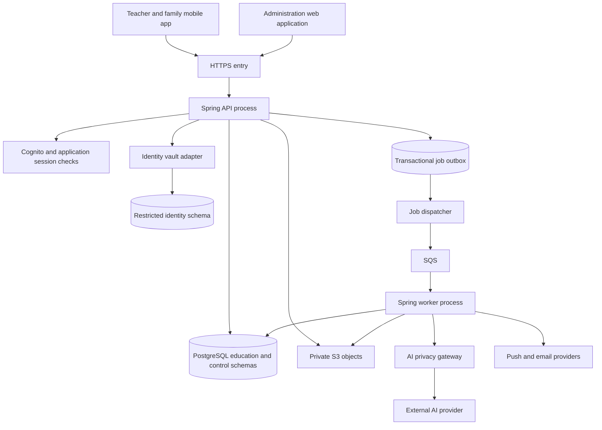
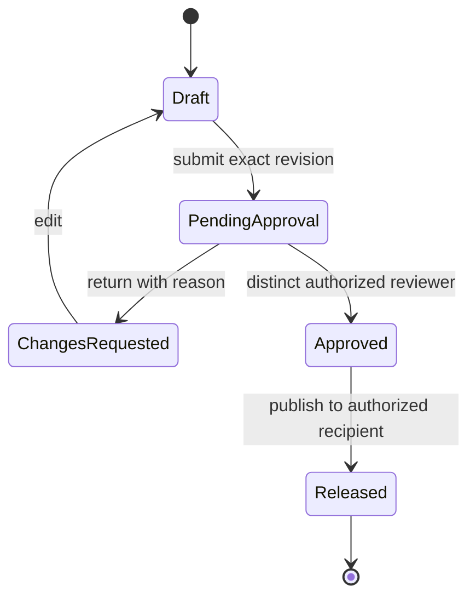
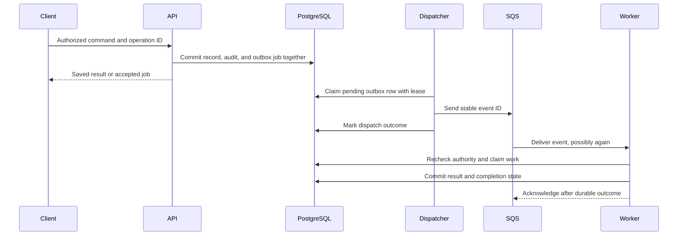

# BMTC technical specification

| Field | Value |
|---|---|
| Document ID | BMTC-TECH |
| Version | 1.0.0 |
| Status | Design baseline; implementation and validation pending |
| Updated | October 11, 2026 |
| Product baseline | BMTC-PRODUCT 1.1.0 |
| Scope | Full product architecture, with staged delivery |
| Market | Vietnam |

## 1. Purpose and authority

This document explains how BMTC should be built and operated. The [product specification](application-specification-v1.md) remains the authority for user behavior, business rules, and release scope. This document owns detailed engineering design. The [documentation guide](README.md) defines independent document versions, Git tags, and change management.

The product supports children needing special education support broadly. Autism-specific screening tools do not define the domain model. School customers use team capabilities; freelance teachers and parents use personal premium capabilities. Payment never substitutes for authorization.

Design status has three meanings:

- **Confirmed** means inherited from an explicit product decision. It does not mean implemented.
- **Proposed** means the engineering approach described here, ready for review and implementation planning. Unless marked otherwise, new details in this document are proposed.
- **Open** means an unresolved choice. A technical proposal must not silently decide an open professional, legal, or commercial policy.

The full module map is a target design, not a requirement to implement every module in the first release. Product section 6.4 remains the delivery scope. No application code, cloud resources, database migrations, or executable API contract exists at this documentation baseline.

## 2. Architecture baseline

### 2.1 Confirmed choices

| Concern | Baseline |
|---|---|
| Backend | LTS Java, Spring Boot, Spring MVC, Spring Security, Spring Modulith |
| Application shape | Modular monolith; pragmatic domain modeling; adapters at real integration seams |
| Persistence | PostgreSQL, RLS, Flyway, jOOQ; no Hibernate or JPA |
| Read and write paths | Separate command and query handlers in one application and database |
| Mobile | React Native, Expo, Expo Router; encrypted local drafts |
| Administration | Next.js and TypeScript |
| Interface contract | REST and OpenAPI with a generated TypeScript client |
| Hosting target | AWS ECS Fargate, RDS, S3, KMS, SQS, Cognito, SES, CloudWatch; ElastiCache in the target stack |
| Delivery | GitHub Actions, Docker, Gradle, pnpm workspace; Terraform or OpenTofu |

Exact Java, framework, database, Expo, and build-tool versions are open. Before implementation, record and test a compatible version set. Commit lockfiles, the Gradle wrapper, dependency constraints, and container image digests. Do not combine unrelated latest versions by assumption. Verify jOOQ edition and licensing against the selected database and Java versions.

### 2.2 Runtime topology



API and worker processes may use the same application artifact with different runtime profiles. They share module implementations and schema ownership; separate processes do not imply microservices. Give each process only its required network and IAM permissions.

Use ElastiCache only for a defined cache or coordination requirement after correctness works without it. Do not make cache availability a prerequisite for saving an observation. This deployment proposal needs confirmation against the target stack, see TD-012.

## 3. Module ownership and interfaces

Each module owns its domain rules and tables. It exposes a small interface of commands, queries, and versioned event contracts. Callers must not import its internal repositories, generated jOOQ tables, or adapters.

| Module | Owns | Examples of public operations |
|---|---|---|
| `identityaccess` | Accounts, application sessions, actor context, policy evaluation | Resolve actor; check action; revoke session |
| `organization` | Schools, branches, memberships, staff assignments | Resolve membership; assign teacher; end assignment |
| `childprofile` | Identity mapping, family links, learning profiles, sharing grants | Resolve learning profile; evaluate sharing; revoke grant |
| `observation` | Activity evidence, taxonomy versions, observation revisions | Save draft; confirm record; correct record; list evidence |
| `curriculum` | Goals, lesson templates, lesson versions, plans | Change goal; publish approved lesson; retrieve permitted lessons |
| `scheduling` | Classes, planned sessions, actual attendance, delivery facts, handoff | Schedule session; record attendance; confirm delivery |
| `reporting` | Report drafts, evidence manifests, reviews, released versions | Build draft; submit; review; release; retrieve permitted version |
| `screening` | Tool definitions, deterministic scoring, attempts, follow-up state | Start permitted tool; record response; complete approved scoring |
| `payroll` | Compensation rules, effective rates, work approvals, payroll adjustments | Calculate period; approve work; lock period; adjust |
| `incident` | Restricted incidents, escalation state, notification evidence | Record incident; assign responder; record action |
| `notification` | Delivery intent and attempts | Schedule delivery; record provider outcome |
| `aiassistance` | Task validation, minimization, prompt versions, job results | Request wording edit; retrieve pending suggestion |
| `platformadministration` | Workspace lifecycle, support grants, platform configuration | Suspend workspace; request support access; inspect service state |
| `commercialaccess`, proposed | Billing accounts, plan versions, entitlement grants, usage reservations | Resolve feature eligibility; reserve usage; apply verified payment event |
| `audit`, proposed | Durable audit events and restricted audit queries | Append security event; list authorized access history |

The last two modules extend the conceptual product module list. They are proposed owners for already required premium and audit responsibilities; they do not commit to a payment provider or package structure.

Commands return meaningful domain outcomes instead of leaking persistence exceptions. Use semantic identifiers such as UserId, WorkspaceId, LearningProfileId, and ReportVersionId. A signature must not accept interchangeable raw strings for these concepts.

Model states as explicit variants. A submitted report must carry its submitted revision and author; an approved report must carry its approver and immutable content version. Do not represent these as unrelated optional fields that allow contradictory combinations.

Parse untrusted HTTP payloads, provider messages, configuration, and stored representations into validated types at their adapters. Internal domain functions can then trust structural validity. Authorization, current membership, uniqueness, and concurrent state are separate runtime facts that must still be checked at the transaction that uses them.

### 3.1 Dependency and query rules

- `identityaccess` evaluates action policies using narrow membership and sharing interfaces. Membership and sharing owners do not call back into the evaluator during the same operation.
- `reporting` requests evidence through the observation and curriculum interfaces. It owns any reporting projections it builds from their events.
- `notification` receives delivery intents. It does not inspect observation or report tables directly.
- `commercialaccess` answers feature eligibility; it does not grant child-record access.
- Cross-module synchronous reads use public query interfaces. Joins over another module's tables are not permitted by placing them in a query handler.
- Reporting projections are event-driven and explicitly eventually consistent. Record their latest processed source version and expose pending work to users.
- Confirming a record returns the authoritative result immediately; a stale projection must not make a successful write appear lost.

Use Spring Modulith structure verification for module cycles and access restrictions, plus ArchUnit for BMTC rules. Framework verification does not prove business authorization. [Spring Modulith verification](https://docs.spring.io/spring-modulith/reference/verification.html)

## 4. Repository and build structure

```text
docs/
  README.md
  CHANGELOG.md
  application-specification-v1.md
  technical-specification-v1.md
  adr/
contracts/
  openapi/
apps/
  admin-web/
  mobile/
services/
  backend/
    src/main/java/<base-package>/<module>/
      api/
      internal/application/
      internal/domain/
      internal/adapter/
    src/main/resources/db/migration/
packages/
  generated-api-client/
infra/
  terraform/
```

Only the documentation paths exist today. The remaining paths describe the intended implementation.

`api` contains a module's public interface, not its HTTP controllers. Controllers live in the inbound adapter. Application handlers establish transactions and coordinate domain behavior. Domain code imports neither Spring MVC nor jOOQ nor provider SDKs. SQL and remote calls belong in adapters.

Flyway migrations are the schema source. Generate jOOQ against a disposable database migrated to the intended version, using a separate code-generation role. Do not generate against production. jOOQ supports schema-derived code generation; BMTC's build should fail when generated artifacts no longer match the migration baseline. [jOOQ code generation](https://www.jooq.org/doc/latest/manual/code-generation/)

OpenAPI under `contracts/openapi` is the proposed source of truth for transport contracts. Generate clients from it and verify server conformance. Domain types remain independent of generated wire types. Document whether generated files are committed or rebuilt in CI before adding the first contract.

## 5. Workspaces, identities, and sharing

### 5.1 Isolation model

**Proposed, ADR-0002:** represent school, independent-teacher, and family workspaces as three variants of a common isolation principal. Keep `tenant_id` as the physical partition column. A family tenant provides isolation, not organizational authority over other records.

| Concept | Meaning |
|---|---|
| User | One sign-in identity, potentially participating in several workspaces |
| Workspace | An isolation principal of kind SCHOOL, INDEPENDENT, or FAMILY |
| Membership | A user's roles and effective scope within a workspace |
| Child identity | Restricted identifying information controlled through the family relationship |
| Learning profile | Provider-specific education identity within its owning workspace |
| Sharing grant | An explicit, purpose-bound permission between parties |
| Billing account | A commercial payer, kept separate from data authority |

Use different learning-profile identifiers in different provider workspaces. Do not expose a platform-wide child identifier in ordinary education responses. The restricted identity mapping records approved relationships.

Do not auto-merge children by name, phone number, date of birth, or similar fields. A linking workflow must handle temporary school records, verified confirmation, rejection, and reversal. Guardian authority and dispute handling remain product decisions, TD-003.

### 5.2 Cross-workspace reads

An ordinary database transaction has exactly one owning workspace context. The client cannot request an arbitrary second tenant or a comma-separated list of allowed tenants.

An approved sharing read follows a dedicated operation:

1. Resolve the authenticated requester and their current relationship to the child.
2. Read the authoritative sharing grant through a restricted policy interface.
3. Bind the grant to a particular source workspace, resource scope, purpose, and recipient.
4. Run the source-owner read under an explicit authorized context, with resource and field restrictions.
5. Return a permitted projection, record the grant and access in audit, and discard the source context.

The policy lookup may use a separate role that sees only relationship metadata. Do not introduce a general service role with unrestricted child-table access. RLS remains active for source reads; application checks narrow access within the source tenant.

Published report access after grant revocation or school cancellation remains open. Store release and recipient metadata so the chosen policy can be implemented without reconstructing history. Do not assume permanent access or automatic deletion.

## 6. Authentication and authorization

### 6.1 Actor resolution

For every request, validate token signature, issuer, intended client or audience as applicable, token purpose, expiry, and the application session. Map the provider subject to an internal UserId. Do not use email as the durable identity key.

A selected workspace and role are requested context, not authority. Resolve current membership and permitted acting scope on the server. A long-lived token must not preserve a removed role.

Proposed client patterns:

- Mobile uses an authorization-code flow with PKCE and platform-protected credential storage.
- The web administration layer uses secure, HttpOnly session cookies and server-side token handling. Protect state-changing requests against CSRF. The backend still checks all authorization.
- Platform administration uses a separate internal identity context with mandatory MFA, short sessions, and no inherited tenant-content access.

Cognito token revocation does not cause a generic JWT verifier to discover revocation automatically. BMTC therefore needs current application session state in addition to signature checks. [Cognito revocation behavior](https://docs.aws.amazon.com/cognito/latest/developerguide/token-revocation.html)

### 6.2 Access decision

Evaluate: authenticated actor, active session, requested action, active role, workspace, branch or class assignment, resource relationship, data sensitivity, sharing purpose, and grant lifetime. Evaluate feature entitlement separately after the actor is authorized to perform the action.

Cache permissions only with a defined invalidation mechanism. Initially, sensitive writes and exports should read authoritative state. A client hiding a button is not an access check.

Serialize membership or sharing revocation against sensitive writes using a common authorization-version row or equivalent locking scheme. Define the revocation commit as the point after which newly authorized server operations must fail. Long jobs recheck permission before reading inputs and before publishing results. Already delivered bytes cannot be recalled.

For inaccessible objects, use an existence-hiding response consistently. Validation errors must not reveal another tenant's records through foreign-key, uniqueness, or search results.

### 6.3 Support access

Support grants include requester, approving authority, reason, tenant, resource and action scope, start, expiry, and revocation. Proposed rule: the requester cannot approve their own grant. The exact approver policy is open, TD-004.

The grant is evaluated on each action, does not use `BYPASSRLS`, and is visible in tenant audit. Expiration prevents further access even if a support session remains open. Do not enable support impersonation until these checks are tested.

## 7. Database security and data representation

### 7.1 Roles and tenant context

Use separate migration-owner, ordinary runtime, identity-vault, policy-lookup, and operations roles. The runtime role cannot own tables, alter policies, assume the migration role, or bypass RLS. Default schema and function grants must be reviewed explicitly.

Set tenant context on the transaction's own connection before any tenant query. PostgreSQL's `set_config` with a true third argument scopes a setting to the current transaction. [PostgreSQL configuration functions](https://www.postgresql.org/docs/current/functions-admin.html)

Illustrative SQL, not a complete migration:

```sql
BEGIN;
SELECT set_config('app.tenant_id', :authorized_tenant_id, true);
-- Execute this operation's queries on the same transaction connection.
COMMIT;

ALTER TABLE observation.observation ENABLE ROW LEVEL SECURITY;
ALTER TABLE observation.observation FORCE ROW LEVEL SECURITY;

CREATE POLICY observation_tenant_policy
ON observation.observation
FOR ALL TO bmtc_runtime
USING (
  tenant_id = NULLIF(current_setting('app.tenant_id', true), '')::uuid
)
WITH CHECK (
  tenant_id = NULLIF(current_setting('app.tenant_id', true), '')::uuid
);
```

The parameter above is resolved by server authorization and bound through the database adapter. Never interpolate a client string into SQL. Missing context denies rows; malformed context fails the operation. New transactions, including worker and nested transactions, must establish their own context.

RLS applies to ordinary roles, while superusers and `BYPASSRLS` roles bypass it; table owners normally bypass it unless forced. Audit migrations for those conditions. [PostgreSQL row security](https://www.postgresql.org/docs/current/ddl-rowsecurity.html)

This tenant policy is one defense against programming errors. It does not enforce branch or child assignments and does not stop a compromised application role from setting a different context. Resource authorization, parameterized SQL, least privilege, and deployment controls remain necessary.

### 7.2 Integrity and indexes

- Give tenant-owned entities a unique composite key on `tenant_id, id`. Use tenant-qualified foreign keys to prevent cross-tenant references.
- Include branch ownership checks where a branch ID is stored. Do not rely on two unrelated foreign keys to establish that a branch belongs to the same school.
- Use an integer revision for optimistic concurrency. Updates compare the expected revision and increment atomically.
- Use UTC instants for events and audit. Use local dates for date of birth, school days, and payroll periods. Use `Asia/Ho_Chi_Minh` for Vietnam calendar calculations.
- Store money as a decimal amount with currency or as a documented integer minor-unit type. Never use floating-point calculations for pay or billing.
- Use JSON only for bounded, versioned content where flexibility is required. Keep keys, ownership, lifecycle state, and common query fields relational.
- Start query indexes with tenant and relevant filters, such as child, class, date, status, or due time. Verify actual execution plans with representative data.
- Do not add vector search as a prerequisite for the lesson library. Establish whether structured filtering and ordinary text search meet retrieval needs first.

### 7.3 Identity vault

The proposed first implementation uses a restricted schema and separate database role, with application-level encryption for identity fields under a separate KMS key. Education records remain pseudonymous and sensitive.

Separate storage encryption does not protect plaintext from an application that can decrypt both domains. Keep identity lookup behind a small audited interface and minimize identities joined into operational screens. A separate database or deployment is an option if the threat model justifies it, TD-002.

Audit identity access, export, linkage, and un-linkage. Do not put names or contact details into object keys, queue messages, URLs, metrics labels, or tracing attributes.

## 8. Core data aggregates and lifecycles

| Aggregate | Important state and invariants |
|---|---|
| Observation | Child, activity, author, time, taxonomy version, content revision, confirmation; each child has separately confirmed evidence |
| Goal | Owner, dated definition, baseline where supplied, measurement criteria, support context, review date, status history |
| Report | Reporting period, immutable evidence manifest, editable narrative revision, author, reviewers, approved version, recipient scope |
| Session | Planned time, assignments, cancellation state; actual attendance and delivery recorded separately |
| Lesson | Approved source version, approval authority, plan adaptations, withdrawal state |
| Sharing grant | Subject, parties, resources, purpose, effective interval, revocation, authorization version |
| Screening attempt | Tool and scoring version, eligibility, responses, completion and follow-up states |
| Payroll period | Work and rate snapshots, approval, lock, explicit adjustments |
| Entitlement grant | Payer or plan reference, beneficiary scope, feature, limit, validity, state |

### 8.1 Observation revisions

Proposed progression: Draft, Confirmed, then a new correction revision. A correction preserves the previously confirmed revision. It does not silently change a released report.

Keep raw teacher text, AI suggestion, and selected confirmed content as distinct fields or records. Record which suggestion version, if any, informed the confirmed revision. Shared class context has batch provenance; individual outcomes require confirmation for each child.

Attendance absence, not observed, not attempted, and observed outcome are separate concepts. Do not encode all four as a numeric zero. Retain taxonomy option ID, version, label, and measurement meaning as used at capture time.

### 8.2 Report review and release



Approved content is immutable. Delivery status is separate from approval status: an email failure does not unapprove a report. A correction creates a new report version and review cycle, with a link to the version it supersedes.

Submission freezes a narrative revision and evidence manifest. Approval must check that exact submission. Edits invalidate pending approval. Source corrections flag drafts and pending reviews; do not silently replace source versions during approval.

An evidence manifest includes observation revision IDs, goal-definition versions, reporting interval, template version, and aggregation version. Reports retrieve source revisions through owner interfaces. Any AI-generated narrative also records model, prompt, and minimized-input provenance under the AI retention policy.

Retain the released report's approved content independently of live rendering against mutable source rows. If permitted source deletion later removes evidence, display its unavailability accurately rather than substituting a different observation. The retention relationship between evidence and published reports remains TD-005.

### 8.3 Scheduling and compensation

Separate planned, canceled, attended, and delivered facts. A teacher's recorded work can differ from child attendance. Neither automatically defines family billing or payroll entitlement.

For later recurring schedules, store a recurrence definition and dated occurrences with explicit exceptions. An edit must identify whether it affects one occurrence or future occurrences. Past delivered sessions are not rewritten by recurrence changes.

Enforce booking conflicts atomically with suitable database constraints or locking, not a read-then-insert check alone. Capacity, co-teaching, substitutions, and travel time need explicit policies before implementation.

Payroll uses effective-dated rates and approved delivery snapshots. Locking freezes the calculation inputs and rule version. Post-lock corrections create adjustments. Rounding, prorating, cancellations, and deductions remain open business rules.

### 8.4 Proposed relational records

This is a field-level starting point for migrations, not a final schema. UUID identifiers, UTC timestamps, explicit revisions, and tenant-qualified references follow section 7. Business policy decisions can still change cardinality or retention.

| Record | Key fields | Constraint or ownership rule |
|---|---|---|
| Workspace | id, kind, lifecycle state, created time | Kind is SCHOOL, INDEPENDENT, or FAMILY under proposed ADR-0002 |
| Membership | tenant ID, user ID, role, scope reference, effective interval, authorization version | Scope belongs to the same workspace; ending membership does not delete authored records |
| Learning profile | tenant ID, id, state, created time | Provider-specific identifier; no public global child identifier |
| Identity mapping | identity ID, owner reference, provider workspace and learning-profile reference, verification state | Restricted vault role; no inferred link from matching names |
| Sharing grant | id, granting authority, subject, source and recipient, purpose, scope, start, expiry, revoked time, revision | Deliberate cross-workspace metadata owned by `childprofile`; exactly scoped resource access |
| Observation | tenant ID, id, child reference, session or manual activity reference, author, current revision | One aggregate per individual record; client operation ID unique in its documented scope |
| Observation revision | tenant ID, observation ID, revision, structured evidence, original note, selected content, taxonomy version, confirmation actor/time | Unique aggregate revision; a confirmed version is immutable |
| Goal version | tenant ID, goal ID, version, criteria, measurement definition, support context, owner, review date | Evidence links identify the version used when observed |
| Report version | tenant ID, report ID, version, period, template version, narrative, evidence manifest, content hash | Approved version immutable; corrections create a new version |
| Report review | tenant ID, submission ID, content version/hash, author, reviewer, decision, reason, decision time | Decision applies only to the frozen submission; actor separation enforced |
| Outbox job | tenant ID, event ID, event schema, resource reference, payload, state, lease expiry, attempts, next attempt time | Insert with the business transaction; queue payload excludes raw child content |
| Processed event | consumer ID, event ID, tenant ID, outcome reference, processed time | Unique consumer/event pair committed with the database effect |
| Idempotency operation | actor, tenant ID, operation type, key, request fingerprint, result reference, expiry | Same key cannot represent a different payload |

Store free-text content in protected columns, with size limits and a defined encryption strategy. Do not duplicate identifying fields into reporting projections. A later schema review must specify nullable fields by lifecycle state, required composite foreign keys, and each table's RLS policy before the first production migration.

## 9. HTTP contracts and concurrency

### 9.1 Interface conventions

Proposed base path: `/api/v1`. This API version is independent of BMTC-TECH 1.0.0. Backward-compatible additions do not require a new URL version; breaking transport changes do.

| Operation example | Method and path | Concurrency or retry rule |
|---|---|---|
| Today's work | GET `/workspaces/{workspaceId}/today?date=YYYY-MM-DD` | Current authorization; local date interpreted in school timezone |
| Create observation | POST `/workspaces/{workspaceId}/observations` | Idempotency key and client operation ID |
| Edit draft | PATCH `/workspaces/{workspaceId}/observations/{id}` | Required `If-Match` revision |
| Confirm observation | POST `/workspaces/{workspaceId}/observations/{id}/confirmations` | Expected revision and idempotency key |
| Request wording help | POST `/workspaces/{workspaceId}/ai-jobs` | Authorized source revision; 202 with scoped job reference |
| Submit report | POST `/workspaces/{workspaceId}/reports/{id}/submissions` | Freeze expected content revision |
| Review report | POST `/workspaces/{workspaceId}/reports/{id}/reviews` | Exact submission ID; reviewer separation |
| Revoke sharing | POST `/sharing-grants/{id}/revocations` | Current granting authority; idempotent outcome |

The workspace path identifies a requested context only. The backend resolves authority as described in section 6. Endpoint examples are design contracts, not implemented routes.

Use bounded cursor pagination with stable ordering. Allowlist filters and sort fields. Default search and exports to the actor's permitted scope before aggregation. Limit body size, text length, batch size, and date ranges in the contract.

Use RFC 9457 problem details with a stable application error code and correlation ID. Return safe field errors without echoing sensitive submitted text. [RFC 9457](https://www.rfc-editor.org/rfc/rfc9457.html)

Proposed mappings: 400 for malformed input, 401 for absent or invalid authentication, 403 for an action denied within a visible context, 404 for missing or inaccessible resources, 409 for a business-state conflict, 412 for an outdated `If-Match`, 428 for a missing required precondition, and 429 for rate limits. Distinguish retryable failures from input or policy failures.

### 9.2 Idempotency

Scope an idempotency key to actor, workspace, operation, and a request fingerprint. Persist the result reference with the business transaction. Repeating the same request returns the original result; reusing the key for a different payload returns a conflict. Concurrent identical requests must converge on one business effect.

Authorize every retry before returning a stored result. An old key must not bypass revoked access. Prefer storing a resource reference and safe response metadata rather than duplicating sensitive bodies.

Set key retention at least as long as the documented retry window. For delayed mobile operations, keep a unique client-operation identifier with the business record so deduplication does not disappear merely because a response cache expired.

### 9.3 Confirm-observation transaction

The following sequence makes the proposed concurrency rules concrete:

1. Parse the command into typed values and establish the authenticated actor and requested workspace.
2. Begin a transaction, establish tenant context, and obtain the authorization-version locks needed to serialize with assignment or grant revocation.
3. Resolve current permission and any applicable feature entitlement. Ordinary manual confirmation does not depend on AI entitlement.
4. Resolve the idempotency operation and lock or conditionally update the target observation at the expected revision.
5. Verify the child, activity, attendance context, current draft, and required individual confirmation.
6. Write the immutable confirmed revision and current aggregate pointer. Persist the audit event, idempotency result reference, and required durable publication intents in the same transaction.
7. Commit and return the confirmed revision. Do not call AI, email, or object storage inside this transaction.
8. Update summaries and other projections asynchronously. The client displays the committed result while dependent projections catch up.

A failed transaction leaves none of these database effects committed. A lost HTTP response can be retried with the same operation ID. A policy or record conflict returns a defined error while preserving the client's local draft. Test lock ordering so bulk class confirmation cannot deadlock unpredictably; process aggregates in a stable order or use separate per-child operations with explicit partial results.

## 10. Mobile drafts and synchronization

Use an encrypted local database for drafts associated with an already opened, authorized activity. Store only necessary context. Keep tokens and database keys in platform-protected storage, not in the database or source code.

Expo's SQLCipher support requires native configuration and is unavailable in Expo Go. Encrypted-draft verification must therefore use the actual development or release build. [Expo SQLite and SQLCipher](https://docs.expo.dev/versions/latest/sdk/sqlite/)

Each local operation records workspace, actor, activity or record ID, client-operation ID, base server revision, local creation time, payload-schema version, and synchronization state. The device timestamp is evidence of capture time, not the source of ordering authority.

Proposed synchronization states: LocalDraft, PendingUpload, Uploading, Synced, Conflict, and AccessRevoked. Show the difference between local durability and server confirmation.

1. Save locally before indicating that a draft is safe.
2. On connectivity, reauthenticate and recheck authorized workspace context.
3. Upload with its operation ID and base revision.
4. Retry transient errors with bounded backoff and jitter.
5. On a revision conflict, show the user's draft and current server content for explicit resolution.
6. On lost permission, stop upload and follow the approved local cleanup policy. Never redirect the draft into another workspace.

Partition caches by account and workspace. On switch or logout, stop pending UI requests and clear displayed child data immediately. Handle draft retention and deletion under an explicit policy, TD-009. A server cannot promise instant deletion on a disconnected device.

Test app termination during write, upgrade migrations, restored device backups, duplicate uploads, logout, account switching, and corrupted storage. Full offline rosters and report approval are not part of the pilot. The long-term offline scope remains a separate decision.

## 11. Background work and event delivery

**Proposed, ADR-0003:** internal module notifications use Spring Modulith's JDBC event publication registry. External SQS jobs use an explicit transactional outbox and idempotent consumers. Assign each effect to one durable mechanism; do not register the same work twice.

The Modulith registry can persist listener publications in the originating transaction and retain unsuccessful publications for retry. Its JDBC implementation fits the confirmed no-JPA baseline. Configure its schema through Flyway and prove transaction participation in integration tests. [Spring Modulith event publication](https://docs.spring.io/spring-modulith/reference/events.html)

### 11.1 Outbox sequence



The dispatcher claims bounded batches using a lease. A crash before marking a successful send can produce a duplicate. SQS standard queues can also redeliver messages; consumers must be idempotent. [Amazon SQS delivery semantics](https://docs.aws.amazon.com/AWSSimpleQueueService/latest/SQSDeveloperGuide/standard-queues-at-least-once-delivery.html)

Use an inbox or processed-event constraint keyed by consumer and event ID. A worker crash must not leave a permanent processing flag; use expiring leases and attempt counts. Poison messages reach a dead-letter queue with an alert and a controlled replay procedure.

### 11.2 Event envelope and ordering

Each event carries event ID, event type and schema version, owning workspace, aggregate ID and revision, occurred-at instant, initiating actor or service principal, correlation ID, and causation ID. Store references rather than raw child notes in queue payloads.

Do not serialize bearer tokens into messages. The worker reconstructs current authority. Scheduled system tasks use a purpose-limited service principal with explicit resource scope. They do not reuse an expired user's token.

Do not assume event order. Projections compare aggregate revisions, ignore duplicates, and detect gaps that need an owner-interface refresh. Destructive events and source corrections must invalidate affected read models.

External AI and notification calls cannot be made atomic with a PostgreSQL commit. Persist a durable attempt, use provider idempotency where supported, and reconcile ambiguous outcomes. If a provider has no idempotency support, acknowledge the possibility of repeated delivery or cost. Do not claim exactly-once external effects.

## 12. AI privacy and evaluation

### 12.1 Request pipeline

Authorize source access and task eligibility before extracting content. Select approved fields for the task, replace identifiers with request-local placeholders, inspect free text and indirect identifiers, then create a provider request. Run this minimization inside the trusted environment, not by first sending the original note to an external redaction model.

Pseudonymous education content remains sensitive. A name filter is not proof of anonymity. If the gateway cannot safely process the content, block the AI request while preserving manual work.

The request records source revision, task type, prompt version, model identifier, minimization-policy version, output-schema version, and provider attempt reference. Technical logs store metadata only. Reproducibility versus storage of minimized prompts requires a restricted retention policy, TD-007.

Treat notes and retrieved lessons as untrusted content. Keep them separate from task instructions, expose no tools to a wording-edit task, and never let model output select tenant IDs, permissions, or database operations.

### 12.2 Result handling

- Parse provider output against a strict output schema and length limit.
- Preserve numbers, negation, support levels, and uncertainty from the source. Reject malformed output and flag suspected changes in meaning.
- Return a suggestion bound to the source revision. If the teacher edited the source meanwhile, require a new request or explicit comparison.
- Show original and suggested content. Only a user's confirmation creates an official observation.
- AI cannot release reports, approve lessons, decide enrollment, or compute standardized screening scores.
- Recheck access before returning a completed result. Revoked or expired grants must not leave an accessible job-result endpoint.

### 12.3 Later lesson and report generation

Filter retrieved lessons by workspace, sharing scope, approved version, and withdrawal status before constructing context. Do not retrieve globally and filter only after generation. Keep source lesson IDs and versions in the result record.

Report generation uses a bounded evidence package with source revisions. Deterministic code computes counts and dates; AI supplies a reviewable narrative. Summaries must not lose the link to original evidence.

Maintain evaluation sets with synthetic or specifically authorized data, including ambiguous notes, indirect identifiers, contradictory evidence, prompt injection, and cross-child confusion. Review factual additions, omissions, altered meaning, and source validity. Teacher acceptance rate is a usability measure, not an accuracy guarantee.

Cap per-task and per-workspace cost, queue depth, concurrency, and retries. Reserve usage atomically before dispatch and settle it after provider outcome. Document how failed and ambiguous calls affect quota. A kill switch disables AI without blocking ordinary records.

## 13. Premium plans and commercial access

School team access and personal premium access are confirmed customer categories. Pricing, feature packages, billing frequency, provider selection, and account-versus-family entitlement scope remain open.

Proposed records: BillingAccount, PlanVersion, PurchaseOrSubscription, EntitlementGrant, UsageReservation, and ProviderEvent. The name PurchaseOrSubscription is a placeholder until billing terms are decided; do not implement both models speculatively.

Evaluate data authorization first. Resolve the feature grant from the active workspace and applicable plan. Never combine every entitlement on a multi-role account into unrestricted access across school and personal workspaces.

For metered features, use an atomic reserve, complete, or release operation with an idempotency key. Database constraints must prevent concurrent requests from exceeding an enforced limit. The billing provider's webhook is untrusted until signature, origin expectations, and replay controls are verified.

Payment events may arrive late, out of order, or more than once. Deduplicate and reconcile with the provider's authoritative status. Never activate premium solely because a client reports a successful payment screen.

Canceled payments do not directly issue record-deletion commands. Access to historical records and exports follows the still-open product policy, TD-006. Commercial state, record ownership, and retention remain separate.

## 14. Files, exports, notifications, and audit

### 14.1 Files and exports

Use private S3 buckets with encryption and server-generated object keys. Store owner workspace, resource, content type, size, hash, and lifecycle policy in metadata. Do not encode names into object paths.

Uploads, if introduced, require bounded size, validated type, quarantine, and malware inspection before ordinary access. Media support is not confirmed by this document, TD-014.

Authorize every download request. A short-lived signed URL remains usable until its own expiry unless separately invalidated. Use an authenticated download proxy for resources whose revocation requirement cannot tolerate that window. Never put signed URLs into analytics or logs.

Export jobs record requester, approved scope, filters, schema version, and generation time. Recheck authorization when the job runs and when the file is downloaded. Remove expired exports and audit access. Protect CSV exports against spreadsheet formula injection.

### 14.2 Notifications

Persist delivery intent with a deduplication key such as recipient, report version, and channel. Payloads contain no child content. Deep links route through sign-in and fresh authorization.

Distinguish queued, provider-accepted, failed, and read states. Provider acceptance does not mean a parent read a report. Support retries and invalid-device-token cleanup. Urgent incidents require a separate operational escalation route, not an assumption that a push was received.

### 14.3 Audit

Capture actor, effective role, workspace, action, resource reference, time, outcome, policy or grant reference, and correlation ID. Do not copy complete before-and-after clinical or education content into generic audit entries.

Write mutation audit evidence with the transaction. For sensitive reads, record the access before releasing the response or use an explicitly reviewed durable audit path. Ordinary users cannot edit audit history. Administrative access to the audit store is itself audited.

Separate operational logs from the protected audit store. Audit events can contain sensitive relationship metadata and require their own access and retention policy. Long-term immutable storage is a threat-model decision, not a substitute for access controls.

## 15. Retention, deletion, and recovery

Do not implement the product's provisional three-month school retention period as an automatic deletion default. The approved policy must distinguish departure, loss of operational access, archival access, legal hold, family copies, source evidence, and backup expiry.

A deletion job uses a versioned policy and a previewable manifest of affected records, files, projections, AI artifacts, exports, and caches. It rechecks holds and authorization before executing and records an auditable outcome. Use tombstones where needed to prevent a delayed event from recreating deleted content.

Backups expire through a defined cycle. A restore runs in isolation, reapplies deletion and revocation records newer than the backup, and verifies access before traffic is restored. Do not claim a live delete instantly removes all backup copies.

Recoverability includes education data, identity mapping, encryption keys, approved report objects, and schema versions. A database-only restore is insufficient if identity keys or released objects are unavailable.

Define and test RPO and RTO before production data use. Keep their values open until cost, operating coverage, and school needs are agreed. Document who authorizes a restore and who checks that deleted data has not reappeared.

## 16. Deployment and operational controls

- Separate development, staging, and production accounts or equivalent strongly isolated environments. Use synthetic data outside production unless a reviewed anonymization process permits otherwise.
- Select the AWS region only after reviewing data processing and provider locations. Vietnam as the market does not by itself choose a hosting region.
- Keep RDS and Redis off the public internet. Restrict worker egress and service permissions by integration purpose.
- Use workload identities and short-lived deployment credentials. Store secrets in an approved secret store and rotate them without source changes.
- Place the administration web application behind its own authentication flow. Do not cache personalized Next.js pages or responses in a shared public cache; cache scope must include the complete authorization context where caching is allowed.
- Keep production data access out of routine developer roles. Provide metadata-based support and the controlled support grant process.
- Start with the existing monolith. Scale workers independently only when queue or CPU measurements justify it. Avoid a service split without a documented operational benefit.

### 16.1 Build and rollout

CI validates docs and contracts, builds generated clients and jOOQ code, runs module and database checks, scans dependencies and images, and produces immutable artifacts. Application deployment uses those artifacts without rebuilding them differently in production.

Run schema changes through a serialized migration job. Prefer expand-and-contract changes: add compatible structures, deploy readers and writers, backfill with observable progress, then remove old structures after the supported client window closes.

An application rollback is safe only when the database remains compatible. Do not assume reversing a migration recovers data. For destructive changes, test backup or forward-repair procedures before release.

Mobile releases remain installed after a server upgrade. Define the supported client-version window and minimum version policy before adding a breaking API change. Database, event, API, mobile, and document versions are independent.

## 17. Performance and observability

The following are proposed measurements. Numerical budgets other than the existing approximate two-second Today target remain to be set against an agreed workload.

| Measurement | Required definition |
|---|---|
| Today response | End-to-end p95 on a stated device/network and class size; target approximately two seconds |
| Save latency | p95 and p99 server confirmation time, separate from local draft save |
| Job age | Oldest waiting job and time to completed result per job type |
| Projection lag | Time and source revisions between committed evidence and read model |
| Availability | User-facing save and retrieval success rate, excluding defined client errors |
| AI cost | Cost and token volume per task and authorized workspace without child labels |
| Recovery | Measured restore duration and recoverable point from drills |

Propagate correlation IDs across HTTP, outbox, SQS, and provider attempts. Use bounded-cardinality metrics; child IDs must not be metric labels. Scrub request bodies, authorization headers, screenshots, and sensitive breadcrumbs from error reporting.

Alert on lost-save signals, stuck outbox leases, queue age, failed revocation checks, unexpected permission-denial spikes, identity-vault failures, and repeated provider errors. Set alert ownership and response coverage; an alert without a responsible operator is incomplete.

## 18. Verification and acceptance matrix

These are tests to implement with the system. They have not been executed by creating this document.

| ID | Scenario | Required evidence |
|---|---|---|
| TECH-001 | Tenant context absent, malformed, or inherited from a pooled connection | No unintended rows; same physical connection reused safely across tenants |
| TECH-002 | Teacher has tenant membership but no child assignment | Read, search, write, export, and job access denied |
| TECH-003 | Membership or consent revoked during work | New requests denied; sensitive writes serialized with revocation; jobs cannot publish stale access |
| TECH-004 | Shared class note includes absent children | No confirmed outcome for absent or unconfirmed children |
| TECH-005 | Two clients edit one observation | One revision wins; the other receives a conflict without losing its draft |
| TECH-006 | App stops during local save or upload | Draft recovery and duplicate-free server result in the native encrypted build |
| TECH-007 | Reviewer switches roles to approve own report | Rejected by actor identity, not merely by active role |
| TECH-008 | Source evidence changes after submission or publication | Review flag on pending work; approved content and source-version identity preserved |
| TECH-009 | Commit succeeds but dispatcher or worker crashes | Event resumes; no duplicated database effect; external ambiguity is reconciled |
| TECH-010 | Queue event repeated or delivered out of order | Idempotent consumer and correct revision handling |
| TECH-011 | AI adds a fact, exposes identity, or returns malformed output | Blocked or flagged suggestion; no automatic confirmation or publication |
| TECH-012 | Personal premium account requests school content | Feature payment cannot bypass membership or consent |
| TECH-013 | Payment webhook duplicated, forged, or late | Verified and reconciled entitlement state without double usage or accidental activation |
| TECH-014 | Backup restored after later deletion or revocation | Deleted data remains unavailable; revoked relationships remain revoked before traffic resumes |
| TECH-015 | User switches workspace or opens cached web response | No previous workspace content displayed or served |
| TECH-016 | Support grant expires or requester approves it | Expiry enforced; self-approval blocked according to the agreed policy |
| TECH-017 | Runtime role attempts owner-level database actions | Cannot bypass RLS, change policies, or assume migration privileges |
| TECH-018 | API, event, or schema version changes | Supported clients and queued older events remain compatible or follow a documented migration |

Use unit tests for pure rules and module-interface tests for workflows. Use Testcontainers against real PostgreSQL for RLS, constraints, locks, and migrations. Use Playwright for web and Maestro on the native mobile build. Provider adapters need contract and failure tests; fakes alone cannot establish vendor behavior.

## 19. Traceability to product requirements

| Product requirement group | Technical sections | Verification IDs |
|---|---|---|
| AUTH, ORG, CHILD, PLATFORM | 5, 6, 7, 14, 15 | TECH-001, 002, 003, 014, 015, 016, 017 |
| LOG, GOAL | 8, 9, 10, 12 | TECH-004, 005, 006, 011 |
| REPORT | 8, 11, 14 | TECH-007, 008, 009, 010 |
| SCHED, ATTEND, PAY | 8, 9, 11 | TECH-005, 009, 010, 018 plus feature-specific business tests |
| LESSON, SCREEN | 8, 12, 20 | TECH-002, 003, 011 plus approved content and scoring fixtures |
| Premium customer decisions, product 2.15 | 5, 6, 13 | TECH-012, 013 |
| Recovery and operations | 15, 16, 17 | TECH-014, 017, 018 |

The matrix points to engineering mechanisms. It does not replace detailed feature acceptance criteria or imply that deferred features are implemented.

## 20. Open technical and policy-dependent decisions

| ID | Decision | Suggested owner | Needed before |
|---|---|---|---|
| TD-001 | Confirm common isolation model for family, school, and independent workspaces | Engineering and product | Persisting real family or shared child records |
| TD-002 | Identity vault schema versus database, decryption permissions, and key recovery | Security and engineering | Real identity data |
| TD-003 | Guardian authority, temporary-record claiming, duplicates, disputes, age coverage, and cross-provider coordination | Product, professional, and legal teams | Relevant identity and sharing workflows |
| TD-004 | Support approver and emergency policy; long-term professional review and independent-teacher approval | Product, operations, and security | Support access and affected approval workflows |
| TD-005 | Retention by record class, family access to released reports, source corrections, holds, and backup expiry | Product, legal, and security | Real-data retention and automated deletion |
| TD-006 | Premium packages, scope, payment methods, metering, and post-cancellation access | Product, finance, and engineering | Paid features |
| TD-007 | AI provider, region, minimized-input retention, evaluation thresholds, and cost budgets | Security, professional, and engineering teams | External AI enabled |
| TD-008 | Compatible pinned dependency versions, jOOQ edition, infrastructure tool, and code-generation policy | Engineering | Application bootstrap |
| TD-009 | Draft expiry, account switch and logout cleanup, backup treatment, and offline support window | Product and security | Real child content on devices |
| TD-010 | Native device and operating-system support; minimum mobile version policy | Product and engineering | Mobile distribution |
| TD-011 | RPO, RTO, workload assumptions, availability target, and operating coverage | Operations and engineering | Real-data deployment |
| TD-012 | Initial AWS service footprint, web hosting adapter, region, and cache requirement | Engineering, security, and finance | Infrastructure provisioning |
| TD-013 | Cross-module transaction and event implementation details; outbox and registry retention | Engineering | First asynchronous workflow |
| TD-014 | Media and document attachments, imports, export formats, and integrations | Product and security | Those interfaces are enabled |
| TD-015 | Approved screening tools, local content suitability, scoring fixtures, follow-up, and professional responsibility | Professional and product teams | Screening release |

Product-dependent items remain open in the product decision register as well. An engineering implementation must not become the accidental policy decision.

## 21. Decision records and version history

| ADR | Status | Decision |
|---|---|---|
| [ADR-0001](adr/0001-modular-monolith.md) | Accepted from product baseline | Modular monolith with explicit SQL and module ownership |
| [ADR-0002](adr/0002-workspace-isolation.md) | Proposed | Common workspace isolation and explicit sharing |
| [ADR-0003](adr/0003-durable-background-work.md) | Proposed | Internal publication registry and external job outbox |

Versioned source documentation was checked on October 11, 2026. The cited vendor pages describe current behavior; implementation must verify behavior against the pinned versions chosen in TD-008.

| Version | Date | Change |
|---|---|---|
| 1.0.0 | October 11, 2026 | Initial separate technical design covering the full product, aligned with BMTC-PRODUCT 1.1.0; proposals and unresolved policies remain explicit |
